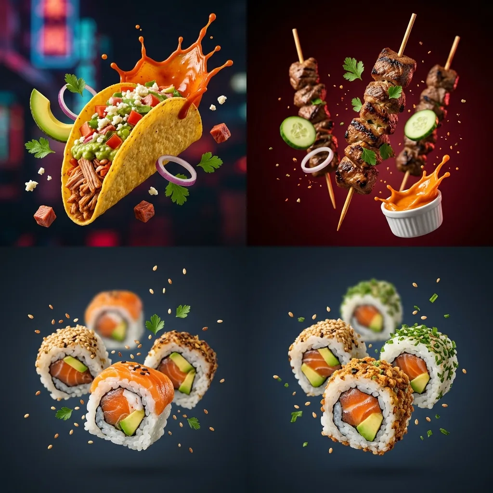

# Rich but natural

[← Back to the collection](../../README.md) · Category: [Food & Drink](../../gallery/food-drink.md) · Model: `Vinano Image v2` · ID: `vn-01426`

<a href="https://vinano.ai?utm_source=github&utm_medium=readme&utm_campaign=awesome-image-video-prompts-updating&utm_content=prompt-page-image"></a>

<sub>Preview generated with <a href="https://vinano.ai?utm_source=github&utm_medium=readme&utm_campaign=awesome-image-video-prompts-updating&utm_content=prompt-page-caption">vinano.ai</a></sub>

## Prompt

```text
{
 "global_settings": {
 "resolution": "8K ultra high definition",
 "aspect_ratio": "2:3 vertical",
 "image_type": "AI-edited cinematic food photography",
 "detail_level": "extreme micro-detail, sharp focus, clean edges",
 "style_constraint": "enhanced realism, minimal alteration from original composition"
 },

 "module_1_image_1_style": {
 "subject": "single hard-shell taco",
 "composition": {
 "orientation": "diagonal, floating in mid-air",
 "foreground_focus": "taco shell and filling",
 "motion": "ingredients suspended, sauce splash frozen mid-air"
 },
 "visible_elements": {
 "shell": "golden yellow hard taco shell crisp texture",
 "filling": ["shredded cooked meat visible fibers",
 "green sauce layered on top",
 "small red diced pieces",
 "white crumbled cheese"],
 "floating_garnish": ["avocado slices",
 "purple onion rings",
 "green herb leaves",
 "small reddish-brown meat cubes",
 "tiny white crumbs"],
 "liquid": "orange-red sauce splash erupting upward behind taco"
 },
 "lighting": {
 "type": "high-contrast studio lighting",
 "highlights": "glossy reflections on sauce and meat",
 "background_lights": "soft circular bokeh in warm and cool tones"
 },
 "background": {
 "color": "dark neon-like blurred lights",
 "depth": "strong depth of field, background fully defocused"
 }
 },

 "module_2_image_2_style": {
 "subject": "three grilled meat skewers",
 "composition": {
 "orientation": "vertical skewers, slightly angled",
 "foreground_focus": "center skewer",
 "motion": "ingredients and sauce suspended"
 },
 "visible_elements": {
 "skewers": "wooden sticks pointed ends",
 "meat": "chunked grilled meat char marks and uneven texture",
 "garnish": "small green herb leaves attached to meat",
 "floating_items": ["round cucumber slices",
 "thin onion rings"],
 "sauce": {
 "container": "small white ramekin",
 "action": "thick orange sauce splashing upward from bowl"
 },
 "particles": "tiny spice or crumb particles scattered in air"
 },
 "lighting": {
 "type": "dramatic directional lighting",
 "highlights": "strong sheen on meat surface",
 "contrast": "deep shadows"
 },
 "background": {
 "color": "solid deep red",
 "texture": "soft grain floating particles"
 }
 },

 "module_3_image_3_style": {
 "subject": "four sushi rolls",
 "composition": {
 "orientation": "floating cluster",
 "spacing": "uneven depth, some closer, some blurred behind",
 "motion": "sesame seeds and herbs suspended"
 },
 "visible_elements": {
 "sushi_structure": {
 "outer_layer": "white rice",
 "inner_layer": "dark seaweed",
 "fillings": ["orange fish slice",
 "green avocado"]
 },
 "toppings": ["toasted sesame seeds",
 "brown crunchy coating",
 "finely chopped green herbs"],
 "particles": ["sesame seeds",
 "small green herb pieces"]
 },
 "lighting": {
 "type": "soft but crisp studio lighting",
 "focus": "front sushi pieces sharp, rear slightly blurred"
 },
 "background": {
 "color": "dark blue-grey",
 "depth": "clean bokeh-free backdrop floating particles"
 }
 },
 "post_processing": {
 "clarity": "ultra-sharp",
 "noise": "minimal",
 "color_balance": "rich but natural",
 "ai_signature": "clean AI-edited look without exaggeration"
 }
}

Aim for an editorial, design-driven look with deliberate negative space.
```

## Try it on vinano.ai

1. Copy the prompt above.
2. Open **[vinano.ai](https://vinano.ai?utm_source=github&utm_medium=readme&utm_campaign=awesome-image-video-prompts-updating&utm_content=prompt-page-try)**, paste it into the image generator and pick a model.
3. Swap any placeholders (brand, product, city, person…) for your own details, then generate.

More prompts like this: [Food & Drink gallery](../../gallery/food-drink.md) · [all categories](../../README.md#contents)
