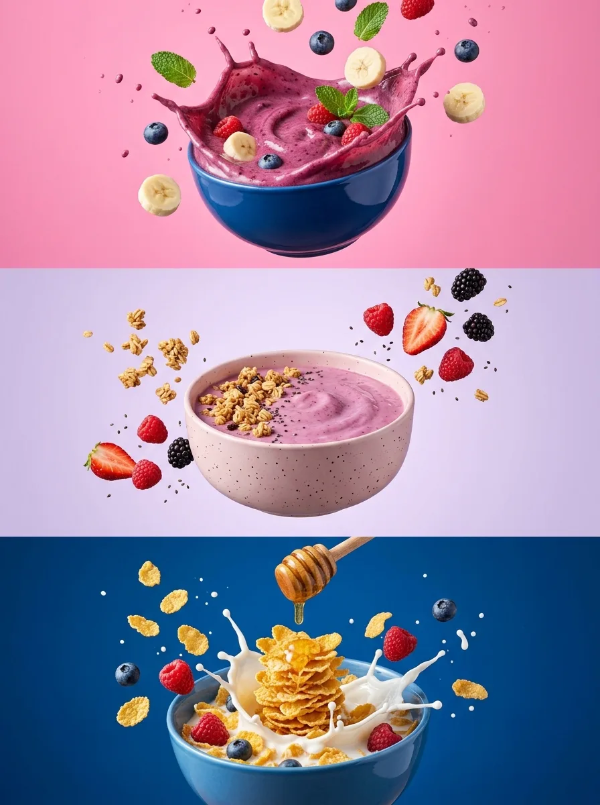

# 3:4 , image style

[← Back to the collection](../../README.md) · Category: [Food & Drink](../../gallery/food-drink.md) · Model: `Vinano Image v2` · ID: `vn-01438`

<a href="https://vinano.ai?utm_source=github&utm_medium=readme&utm_campaign=awesome-image-video-prompts-updating&utm_content=prompt-page-image"></a>

<sub>Preview generated with <a href="https://vinano.ai?utm_source=github&utm_medium=readme&utm_campaign=awesome-image-video-prompts-updating&utm_content=prompt-page-caption">vinano.ai</a></sub>

## Prompt

```text
{
 "resolution": "8K UHD",
 "aspect_ratio": "3:4",
 "image_style": "hyper-realistic commercial food photography",
 "global_settings": {
 "quality": "Ultra-high detail, sharp focus, studio-grade clarity",
 "lighting": "Soft but controlled studio lighting visible highlights and splash definition",
 "motion": "Frozen mid-air action, ingredients suspended",
 "background_style": "Solid or smooth gradient background, color varies per module",
 "camera": "High-speed photography look, shallow to medium depth of field",
 "post_processing": "Balanced contrast, natural saturation, no artificial glow"
 },

 "modules": {

 "module_1_berry_smoothie_explosion": {
 "scene_description": "A vibrant smoothie bowl exploding fruit and liquid splashes",
 "bowl": {
 "color": "Deep blue ceramic bowl",
 "finish": "Glossy",
 "position": "Centered, floating mid-air"
 },
 "base_contents": {
 "type": "Thick berry smoothie",
 "color": "Deep purple-magenta",
 "texture": "Creamy visible swirl marks"
 },
 "ingredients": {
 "fruits": ["Banana slices (round, pale yellow)",
 "Blueberries (whole, dark blue)",
 "Raspberries (whole, red)"],
 "herbs": ["Fresh mint leaves (bright green)"]
 },
 "motion_effects": {
 "liquid": "Berry smoothie splashing upward and outward",
 "particles": "Small droplets suspended in air"
 },
 "background": {
 "color": "Bright pink",
 "texture": "Smooth, seamless"
 }
 },

 "module_2_minimal_pink_smoothie_bowl": {
 "scene_description": "refined minimalist floating smoothie bowl granola and berries",
 "bowl": {
 "color": "Light pink ceramic bowl dark speckles",
 "finish": "Matte",
 "position": "Floating centrally"
 },
 "base_contents": {
 "type": "Smoothie",
 "color": "Soft pink purple undertones",
 "texture": "Thick and smooth"
 },
 "toppings": {
 "granola": "Golden-brown oat clusters",
 "seeds": "Small black seeds scattered",
 "fruits": ["Strawberries (halved)",
 "Raspberries (whole)",
 "Blackberries (whole)"]
 },
 "motion_effects": {
 "ingredients": "Granola flakes, seeds, and berries floating gently"
 },
 "background": {
 "color": "Pastel lavender",
 "gradient": "Subtle, soft gradient"
 }
 },

 "module_3_cereal_milk_honey_splash": {
 "scene_description": "Dynamic cereal stack milk splash and honey drizzle",
 "bowl": {
 "color": "Blue ceramic bowl",
 "finish": "Glossy",
 "position": "Centered, resting visually but surrounded by motion"
 },
 "contents": {
 "cereal": "Golden cornflakes stacked vertically",
 "milk": "White milk splashing and dripping over flakes",
 "fruits": ["Raspberries",
 "Blueberries"]
 },
 "additional_elements": {
 "honey": {
 "source": "Wooden honey dipper",
 "state": "Honey dripping mid-air"
 }
 },
 "motion_effects": {
 "splashes": "Milk splashes frozen in dramatic arcs",
 "particles": "Floating flakes and droplets"
 },
 "background": {
 "color": "Deep blue",
 "tone": "High contrast"
 }
 },
}

Emphasise material texture and natural light so the final frame feels tactile and premium.
```

## Try it on vinano.ai

1. Copy the prompt above.
2. Open **[vinano.ai](https://vinano.ai?utm_source=github&utm_medium=readme&utm_campaign=awesome-image-video-prompts-updating&utm_content=prompt-page-try)**, paste it into the image generator and pick a model.
3. Swap any placeholders (brand, product, city, person…) for your own details, then generate.

More prompts like this: [Food & Drink gallery](../../gallery/food-drink.md) · [all categories](../../README.md#contents)
