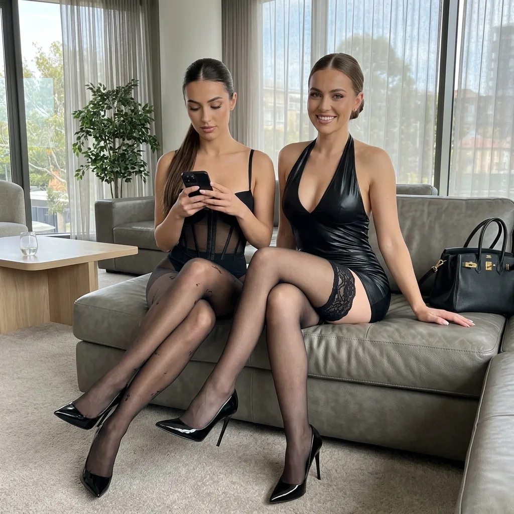

# Realistic, Ai Art

[← Back to the collection](../../README.md) · Category: [Food & Drink](../../gallery/food-drink.md) · Model: `Vinano Image Pro` · ID: `vn-01449`

<a href="https://vinano.ai?utm_source=github&utm_medium=readme&utm_campaign=awesome-image-video-prompts-updating&utm_content=prompt-page-image"></a>

<sub>Preview generated with <a href="https://vinano.ai?utm_source=github&utm_medium=readme&utm_campaign=awesome-image-video-prompts-updating&utm_content=prompt-page-caption">vinano.ai</a></sub>

## Prompt

```text
{ "subject": { "description": "Two stylish young adult women sitting close together on a gray leather sectional sofa in a modern lounge, dressed in sleek black going-out outfits and sheer stockings; left woman looks down at a smartphone a cool, composed expression while the right woman smiles warmly at the camera.", "mirror_rules": "Not a mirror selfie; no mirror artifacts, no mirrored text, no reflection distortions.", "age": "mid-20s", "expression": { "eyes": { "look": "left woman focused on phone screen; right woman engaging the viewer", "energy": "left: calm and aloof; right: bright and inviting", "direction": "left: downward to phone; right: toward camera" }, "mouth": { "position": "left: relaxed closed lips; right: gentle smile showing teeth slightly", "energy": "left: neutral; right: friendly and confident" }, "overall": "a candid pre-night-out moment captured in daylight, contrasting glamorous styling quiet, real-life ease" }, "face": { "preserve_original": true, "makeup": "polished glam makeup: defined brows, eyeliner, soft contour, muted nude lips; right woman slightly brighter lip tone" }, "hair": { "color": "left: dark brown/black; right: light brown/blonde", "style": "left: sleek long ponytail; right: neat updo/low bun a center part", "effect": "smooth, glossy hair tidy edges, no flyaways emphasized" }, "body": { "frame": "slim, model-like proportions for both", "waist": "defined waistlines emphasized by fitted outfits", "chest": "structured neckline on the left; deep V halter neckline on the right", "legs": "long legs extended forward, knees slightly angled, legs crossed/overlapped for an elegant seated pose", "skin": { "visible_areas": "faces, shoulders, arms, upper thighs, knees, lower legs through sheer stockings", "tone": "light to light-medium warm tone", "texture": "skin looks smooth and well-moisturized; stockings add a soft, silky friction texture over the legs", "lighting_effect": "diffused daylight wraps softly, gentle highlight on cheekbones and shoulders, minimal harsh shadow" } }, "pose": { "position": "both seated on the sofa near the edge, close together", "base": "left hand holding a black smartphone; right arm relaxed hand resting near the left woman's knee/thigh area", "overall": "intimate, composed lounge pose slightly angled torsos and forward-pointed heels" }, "clothing": { "top": { "type": "left: black corset-style bodysuit structured seams and sheer cutout panels; right: black glossy halter mini dress deep V neckline", "color": "black", "details": "left: sculpted bust cups, vertical boning lines, semi-sheer geometric panels; right: smooth shiny fabric, clean minimal seams", "effect": "high-contrast fashion silhouette, elegant and upscale rather than playful" }, "bottom": { "type": "left: sheer black pantyhose subtle small lettering print; right: sheer black thigh-high stockings wide lace top band", "color": "black", "details": "both wearing pointed-toe stiletto heels a glossy finish and metallic-looking toe accents", "effect": "legs appear elongated, refined nightlife styling" } } }, "accessories": { "jewelry": "right woman: small hoop or stud earrings and a thin bracelet; minimal jewelry overall", "device": "black smartphone in the left woman's hand", "prop": "black handbag placed on the sofa to the right side of the frame" }, "photography": { "camera_style": "realistic smartphone photo, high-end social media lifestyle aesthetic", "angle": "eye-level to slightly above, subtle tilt, candid framing", "shot_type": "medium full shot capturing both women seated from head to heels", "aspect_ratio": "4:5 vertical", "texture": "clean sharp details mild phone compression, soft natural skin rendering, subtle noise in shadows", "lighting": "soft diffused daylight through sheer curtains, gentle back/side light from large windows, natural ambient fill, no harsh flash", "depth_of_field": "moderate depth of field, subjects crisp, background slightly softened" }, "background": { "setting": "modern indoor lounge or upscale apartment living area floor-to-ceiling windows", "wall_color": "neutral grays and warm wood tones", "elements": ["gray leather sectional sofa", "sheer curtains visible vertical texture", "large window panes outdoor water/greenery view", "potted leafy plant on the left", "light wood square coffee table", "soft neutral carpet"], "atmosphere": "quiet, upscale, daytime calm a hint of pre-evening anticipation", "lighting": "window-lit scene, curtain-filtered highlights, gentle reflections on leather and glossy fabric" }, "the_vibe": { "energy": "soft confidence, poised and intimate", "mood": "daylight serenity meets nightlife glam", "aesthetic": "modern luxury, social-media realism, clean minimal interior", "authenticity": "a real candid moment: one checking messages, one acknowledging the camera", "intimacy": "close seating, relaxed touch, shared frame like a private memory", "story": "they Emphasise material texture and natural light so the final frame feels tactile and premium.
```

## Try it on vinano.ai

1. Copy the prompt above.
2. Open **[vinano.ai](https://vinano.ai?utm_source=github&utm_medium=readme&utm_campaign=awesome-image-video-prompts-updating&utm_content=prompt-page-try)**, paste it into the image generator and pick a model.
3. Swap any placeholders (brand, product, city, person…) for your own details, then generate.

More prompts like this: [Food & Drink gallery](../../gallery/food-drink.md) · [all categories](../../README.md#contents)
