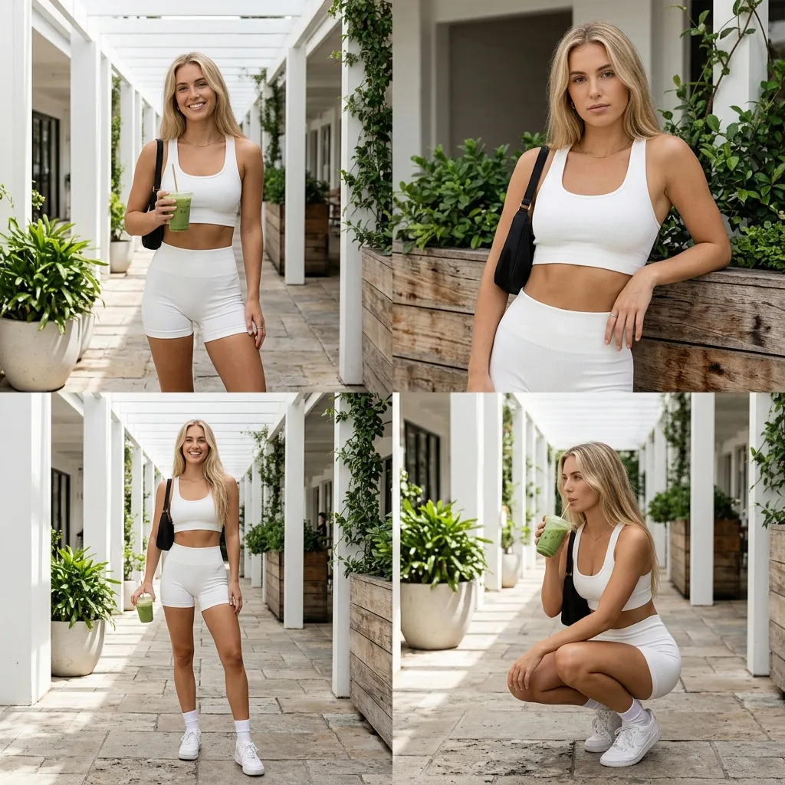

# Portrait, Ai Art

[← Back to the collection](../../README.md) · Category: [Food & Drink](../../gallery/food-drink.md) · Model: `Vinano Image Pro` · ID: `vn-01461`

<a href="https://vinano.ai?utm_source=github&utm_medium=readme&utm_campaign=awesome-image-video-prompts-updating&utm_content=prompt-page-image"></a>

<sub>Preview generated with <a href="https://vinano.ai?utm_source=github&utm_medium=readme&utm_campaign=awesome-image-video-prompts-updating&utm_content=prompt-page-caption">vinano.ai</a></sub>

## Prompt

```text
{
 "type": "image_set",
 "style": "lifestyle fashion photography, clean and aesthetic",
 "layout": {
 "format": "2x2 grid collage",
 "orientation": "portrait images combined"
 },
 "scene": {
 "setting": "outdoor café walkway",
 "environment": {
 "architecture": "white modern building pergola",
 "surroundings": "lush green plants and vines",
 "ground": "stone tile flooring",
 "lighting": "natural daylight soft shadows"
 }
 },
 "subject": {
 "count": 1,
 "appearance": {
 "hair": {
 "color": "blonde",
 "style": "long, loose"
 },
 "expression_range": ["relaxed", "confident", "smiling", "neutral"]
 },
 "clothing": {
 "outfit": "white athletic set",
 "top": "cropped sports bra",
 "bottom": "high-waisted shorts",
 "footwear": "white sneakers crew socks",
 "accessories": ["black shoulder bag", "minimal jewelry"]
 }
 },
 "activity": {
 "action": "holding and drinking a green beverage",
 "drink": "green iced drink in clear cup straw"
 },
 "poses": ["standing casually", "leaning against planter", "smiling while standing", "crouching drink"],
 "composition": {
 "focus": "subject centered in each frame",
 "depth": "clear subject separation from background",
 "balance": "consistent framing across all four images"
 },
 "color_palette": {
 "dominant_colors": ["white", "green", "beige"],
 "accent_colors": ["black", "natural skin tones"]
 },
 "overall_tone": "fresh, healthy, stylish, summer lifestyle"
}

Emphasise material texture and natural light so the final frame feels tactile and premium.
```

## Try it on vinano.ai

1. Copy the prompt above.
2. Open **[vinano.ai](https://vinano.ai?utm_source=github&utm_medium=readme&utm_campaign=awesome-image-video-prompts-updating&utm_content=prompt-page-try)**, paste it into the image generator and pick a model.
3. Swap any placeholders (brand, product, city, person…) for your own details, then generate.

More prompts like this: [Food & Drink gallery](../../gallery/food-drink.md) · [all categories](../../README.md#contents)
