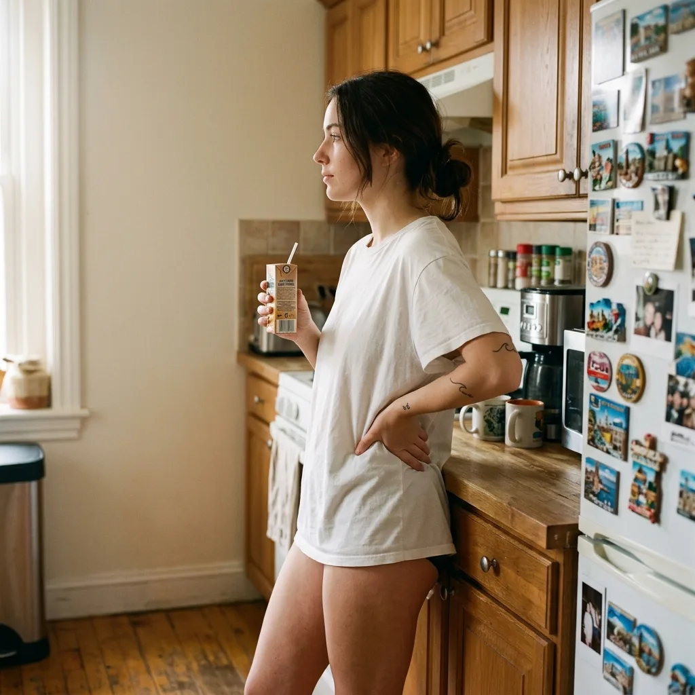

# Realistic, Ai Art

[← Back to the collection](../../README.md) · Category: [Food & Drink](../../gallery/food-drink.md) · Model: `Vinano Image Pro` · ID: `vn-01584`

<a href="https://vinano.ai?utm_source=github&utm_medium=readme&utm_campaign=awesome-image-video-prompts-updating&utm_content=prompt-page-image"></a>

<sub>Preview generated with <a href="https://vinano.ai?utm_source=github&utm_medium=readme&utm_campaign=awesome-image-video-prompts-updating&utm_content=prompt-page-caption">vinano.ai</a></sub>

## Prompt

```text
{
 "type": "image_generation_prompt",
 "style": "true-to-life photorealistic, lifestyle photography",
 "sexualization": "none",
 "description": {
 "subject": "A young woman standing casually in a home kitchen, seen in side profile",
 "pose": "Relaxed posture, one hand resting on her hip while the other holds a small drink carton a straw",
 "expression": "Neutral, thoughtful, slightly distant gaze looking forward",
 "appearance": {
 "hair": "Dark hair tied in a loose low bun natural strands framing the face",
 "clothing": "Oversized white t-shirt worn casually, simple underwear partially visible due to the relaxed fit of the shirt",
 "tattoos": "Small, minimal black-ink tattoos on the forearm, subtle and understated"
 }
 },
 "environment": {
 "location": "A modest, lived-in home kitchen",
 "details": "Wooden cabinets, countertop appliances, a refrigerator covered colorful magnets and souvenirs",
 "lighting": "Soft natural daylight coming from a window, warm and slightly muted",
 "atmosphere": "Quiet, everyday domestic moment"
 },
 "camera": {
 "angle": "Side profile view",
 "framing": "Medium shot capturing the subject from mid-thigh to head",
 "lens": "35mm lifestyle lens",
 "depth_of_field": "Moderate, background softly in focus to preserve environmental context"
 },
 "image_quality": {
 "realism": "High",
 "texture_detail": "Natural fabric folds, skin texture, and kitchen surface details visible",
 "grain": "Light natural film grain for an authentic look"
 },
 "mood": "Calm, intimate, documentary-style",
 "constraints": ["Non-sexualized, everyday realism",
 "Focus on natural lifestyle and atmosphere",
 "No exaggerated poses or expressions",
 "Candid, slice-of-life aesthetic"]
}

Aim for an editorial, design-driven look with deliberate negative space.
```

## Try it on vinano.ai

1. Copy the prompt above.
2. Open **[vinano.ai](https://vinano.ai?utm_source=github&utm_medium=readme&utm_campaign=awesome-image-video-prompts-updating&utm_content=prompt-page-try)**, paste it into the image generator and pick a model.
3. Swap any placeholders (brand, product, city, person…) for your own details, then generate.

More prompts like this: [Food & Drink gallery](../../gallery/food-drink.md) · [all categories](../../README.md#contents)
