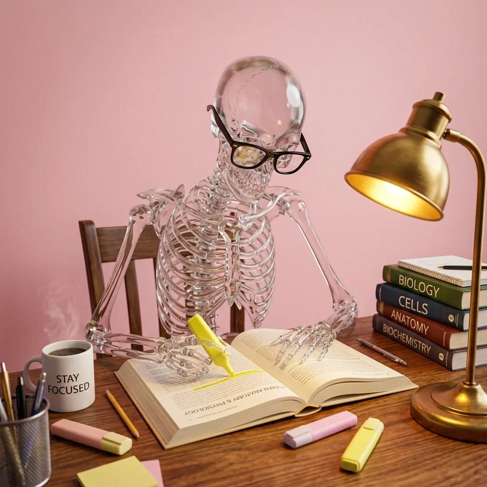

# Premium-quality stylized 3D render of a clear, translucent glass

[← Back to the collection](../../README.md) · Category: [Food & Drink](../../gallery/food-drink.md) · Model: `Vinano Image Pro` · ID: `vn-01682`

<a href="https://vinano.ai?utm_source=github&utm_medium=readme&utm_campaign=awesome-image-video-prompts-updating&utm_content=prompt-page-image"></a>

<sub>Preview generated with <a href="https://vinano.ai?utm_source=github&utm_medium=readme&utm_campaign=awesome-image-video-prompts-updating&utm_content=prompt-page-caption">vinano.ai</a></sub>

## Prompt

```text
Create a premium-quality stylized 3D render of a clear, translucent glass skeleton wearing black-rimmed glasses sitting at a wooden desk. The skeleton MUST be looking down at an open textbook and holding a yellow highlighter, actively highlighting a line of text. The scene MUST feature a warm gold desk lamp on the right side casting a cozy, yellow light that creates glossy reflections on the skeleton's surface. The desk is cluttered a white coffee mug, a stack of hardcover books on the right, and scattered pens and pastel pink and yellow highlighters. The background MUST be a solid, soft pink wall. The overall aesthetic should be warm, studious, and visually soft. Do not include any text overlays or watermarks. Emphasise material texture and natural light so the final frame feels tactile and premium.
```

## Try it on vinano.ai

1. Copy the prompt above.
2. Open **[vinano.ai](https://vinano.ai?utm_source=github&utm_medium=readme&utm_campaign=awesome-image-video-prompts-updating&utm_content=prompt-page-try)**, paste it into the image generator and pick a model.
3. Swap any placeholders (brand, product, city, person…) for your own details, then generate.

More prompts like this: [Food & Drink gallery](../../gallery/food-drink.md) · [all categories](../../README.md#contents)
