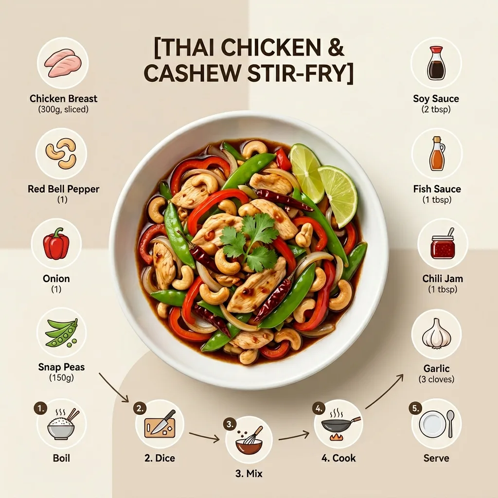

# Realistic, Food Photography

[← Back to the collection](../../README.md) · Category: [Food & Drink](../../gallery/food-drink.md) · Model: `Vinano Image Pro` · ID: `vn-01770`

<a href="https://vinano.ai?utm_source=github&utm_medium=readme&utm_campaign=awesome-image-video-prompts-updating&utm_content=prompt-page-image"></a>

<sub>Preview generated with <a href="https://vinano.ai?utm_source=github&utm_medium=readme&utm_campaign=awesome-image-video-prompts-updating&utm_content=prompt-page-caption">vinano.ai</a></sub>

## Prompt

```text
refined minimalist modern recipe infographic featuring [DISH NAME], presented in a clean top-down / 3-quarter food photography style. The finished dish is centered on a white ceramic plate or bowl, beautifully plated and ultra-realistic. Surrounding the dish are floating ingredient icons soft circular frames and clean vector-style illustrations, each labeled ingredient names and quantities. A curved step-by-step flow simple numbered icons shows the cooking process (boil, dice, mix, cook, serve). Soft neutral background (beige / cream), gentle shadows, balanced spacing, Scandinavian design aesthetic, editorial cookbook layout, high readability typography, subtle gradients, professional food styling, ultra-sharp details, 8K resolution. Emphasise material texture and natural light so the final frame feels tactile and premium.
```

## Try it on vinano.ai

1. Copy the prompt above.
2. Open **[vinano.ai](https://vinano.ai?utm_source=github&utm_medium=readme&utm_campaign=awesome-image-video-prompts-updating&utm_content=prompt-page-try)**, paste it into the image generator and pick a model.
3. Swap any placeholders (brand, product, city, person…) for your own details, then generate.

More prompts like this: [Food & Drink gallery](../../gallery/food-drink.md) · [all categories](../../README.md#contents)
