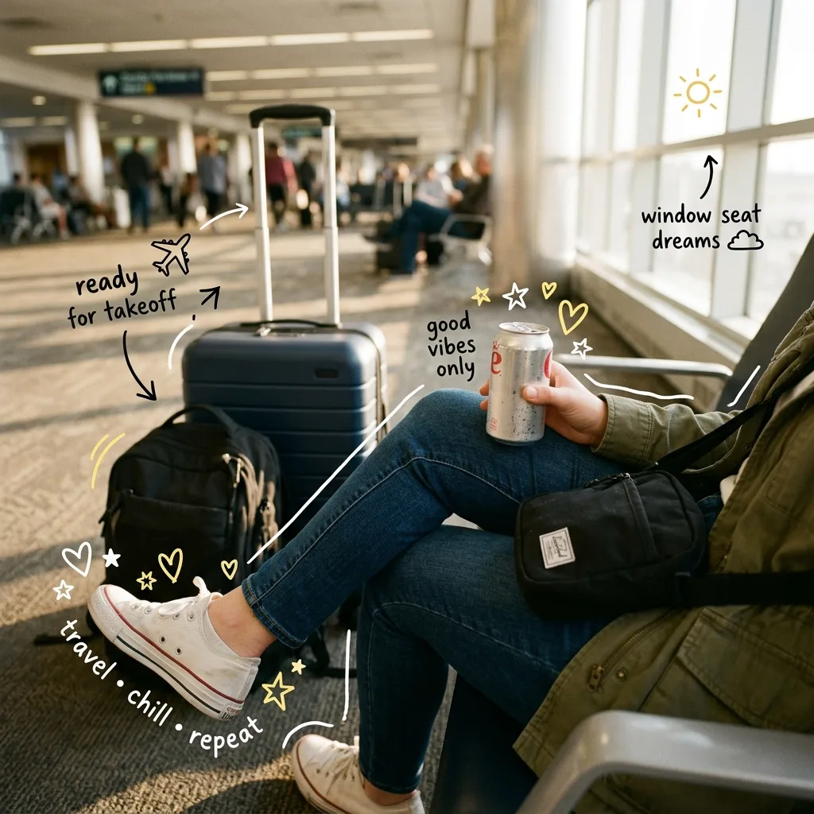

# Realistic, Cinematic

[← Back to the collection](../../README.md) · Category: [Food & Drink](../../gallery/food-drink.md) · Model: `Vinano Image v2` · ID: `vn-01907`

<a href="https://vinano.ai?utm_source=github&utm_medium=readme&utm_campaign=awesome-image-video-prompts-updating&utm_content=prompt-page-image"></a>

<sub>Preview generated with <a href="https://vinano.ai?utm_source=github&utm_medium=readme&utm_campaign=awesome-image-video-prompts-updating&utm_content=prompt-page-caption">vinano.ai</a></sub>

## Prompt

```text
POV travel photography of a person sitting at an airport and inside an airplane, casual outfit jeans and sneakers, small crossbody bag on lap, holding a drink can, warm golden sunlight streaming through windows. Scene 1: airport waiting area luggage (suitcase and backpack), cinematic composition, cozy travel vibe. Scene 2: airplane seat view looking down at legs and tray area, window light casting soft shadows. Add playful hand-drawn doodles and annotations around objects (bags, drink, shoes, seat) including arrows, hearts, stars, clouds, and handwritten notes like “window seat dreams”, “ready for takeoff”, “good vibes only”, “travel • chill • repeat”. White and yellow sketch-style overlays, scrapbook aesthetic, soft warm color grading, shallow depth of field, ultra-realistic, Instagram story style, cinematic lifestyle photography, 4K Render with rich micro-detail while keeping the layout uncluttered and intentional.
```

## Try it on vinano.ai

1. Copy the prompt above.
2. Open **[vinano.ai](https://vinano.ai?utm_source=github&utm_medium=readme&utm_campaign=awesome-image-video-prompts-updating&utm_content=prompt-page-try)**, paste it into the image generator and pick a model.
3. Swap any placeholders (brand, product, city, person…) for your own details, then generate.

More prompts like this: [Food & Drink gallery](../../gallery/food-drink.md) · [all categories](../../README.md#contents)
