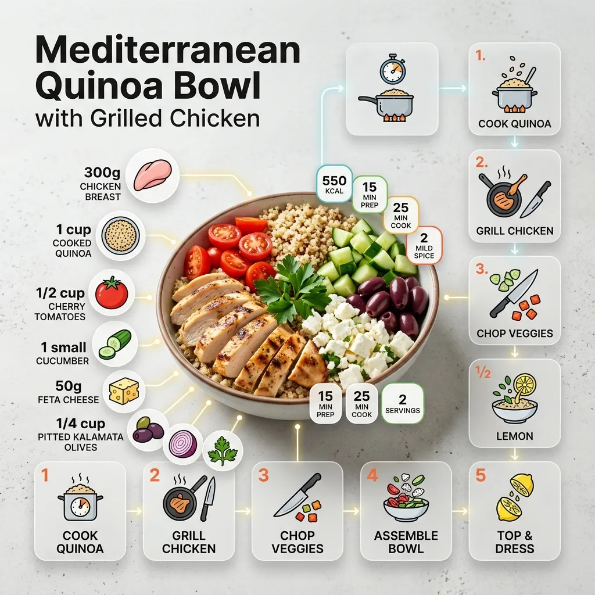

# Food Photography, Infographic

[← Back to the collection](../../README.md) · Category: [Food & Drink](../../gallery/food-drink.md) · Model: `Vinano Image Pro` · ID: `vn-01916`

<a href="https://vinano.ai?utm_source=github&utm_medium=readme&utm_campaign=awesome-image-video-prompts-updating&utm_content=prompt-page-image"></a>

<sub>Preview generated with <a href="https://vinano.ai?utm_source=github&utm_medium=readme&utm_campaign=awesome-image-video-prompts-updating&utm_content=prompt-page-caption">vinano.ai</a></sub>

## Prompt

```text
Ultra-clean modern recipe infographic.

Showcase [FOOD] in a visually appealing finished form—sliced, plated, or portioned—floating slightly in perspective or angled view.

Arrange ingredients, steps, and tips around the dish in a dynamic editorial layout, not restricted to top-down.

Ingredients Section:

Include icons or mini illustrations for each ingredient quantities. Arrange them in clusters, lists, or circular flows connected visually to the dish.

Steps Section:

Show preparation steps numbered panels, arrows, or lines, forming a logical flow around the main dish. Include small cooking icons (knife, pan, oven, timer) where helpful.

Additional Info (optional):

Total calories, prep/cook time, servings, spice level—displayed as clean bubbles or badges near the dish.

Visual Style:

Editorial infographic meets lifestyle food photography. Vibrant, natural food colors, subtle drop shadows, clean vector icons, modern typography, soft gradients or glassmorphism for step panels. Accent colors can highlight key info (calories, prep time).

Composition Guidelines:

Finished meal as hero visual (perspective or angled). Ingredients and steps flow dynamically around the dish. Clear visual hierarchy: dish > steps > ingredients > optional stats. Enough negative space to keep design airy and readable.

Lighting & Background:

Soft, natural studio lighting. Minimal textured or gradient background for premium editorial feel.

Output:

1080×1080, ultra-crisp, social-feed optimized, no watermark

Maintain consistent colour harmony and crisp focus across the whole frame.
```

## Try it on vinano.ai

1. Copy the prompt above.
2. Open **[vinano.ai](https://vinano.ai?utm_source=github&utm_medium=readme&utm_campaign=awesome-image-video-prompts-updating&utm_content=prompt-page-try)**, paste it into the image generator and pick a model.
3. Swap any placeholders (brand, product, city, person…) for your own details, then generate.

More prompts like this: [Food & Drink gallery](../../gallery/food-drink.md) · [all categories](../../README.md#contents)
