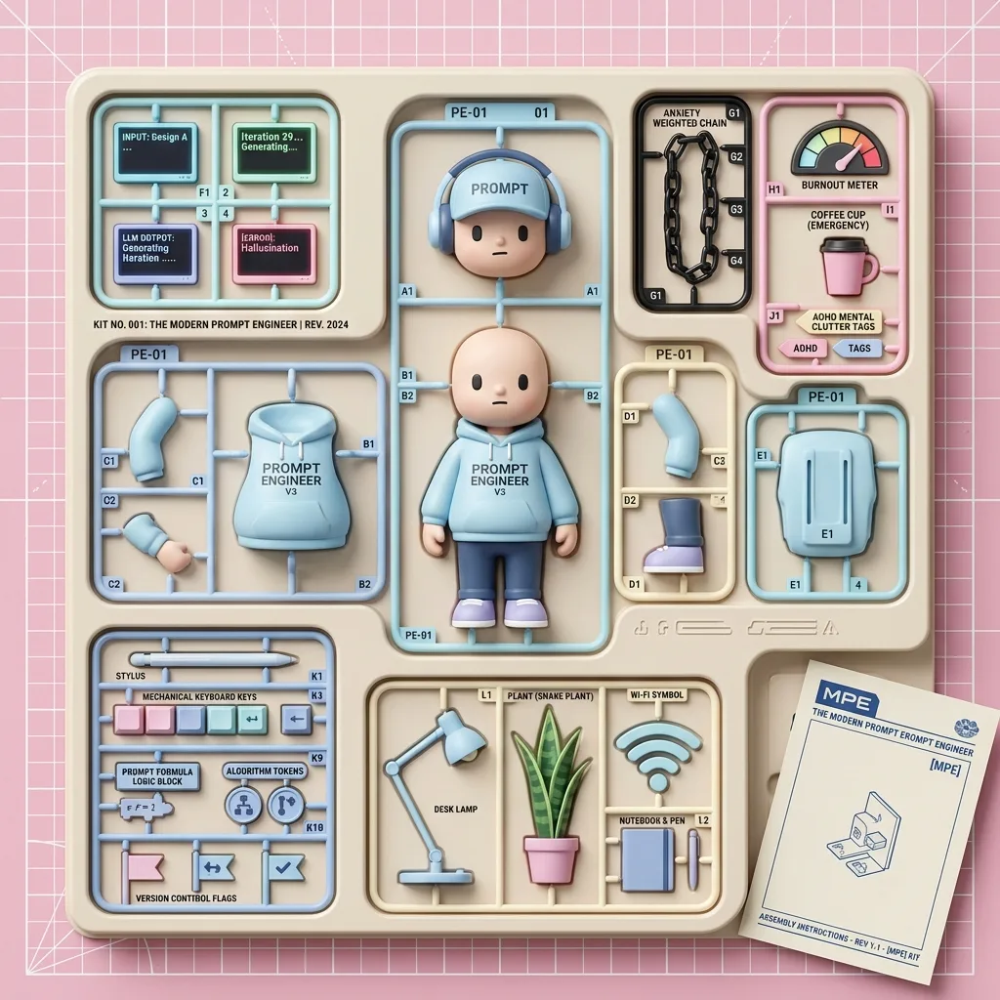

# Food & Drink prompt #2010

[← Back to the collection](../../README.md) · Category: [Food & Drink](../../gallery/food-drink.md) · Model: `Vinano Image Pro` · ID: `vn-02010`

<a href="https://vinano.ai?utm_source=github&utm_medium=readme&utm_campaign=awesome-image-video-prompts-updating&utm_content=prompt-page-image"></a>

<sub>Preview generated with <a href="https://vinano.ai?utm_source=github&utm_medium=readme&utm_campaign=awesome-image-video-prompts-updating&utm_content=prompt-page-caption">vinano.ai</a></sub>

## Prompt

```text
2x2 grid16:9 INPUT = [Profession Or Concept] (e.g., "The Modern Prompt Engineer", "Robot engineer", "The Creative Process", "Nikola Tesla") DECODE_PHENOMENON: - Infer the tools, mental states, and environment of the INPUT. - Translate these into physical, modular accessories. VISUAL_SYSTEM: TOY_KIT_EXPLODED_VIEW (Kaws/PopMart vinyl designer toy::3) + (Gundam runner sprue kit layout::4) + (Pastel Wes Anderson color palette::2) LAYOUT: 16:9. A flat-lay arrangement. The main figure representing the INPUT lies disassembled on a plastic runner frame. Around it, perfectly organized in molded plastic cavities, are its inferred "accessories" (e.g., tiny glowing screens, coffee cups, weighted chains for anxiety, etc.). EXECUTION: Everything must look like pristine, injection-molded matte and gloss vinyl. Include a small, elegant paper instruction manual folded in the corner. Flawless studio overhead lighting, satisfying geometric spacing, highly tactile. Preserve realistic proportions and depth for a confident, professional finish.
```

## Try it on vinano.ai

1. Copy the prompt above.
2. Open **[vinano.ai](https://vinano.ai?utm_source=github&utm_medium=readme&utm_campaign=awesome-image-video-prompts-updating&utm_content=prompt-page-try)**, paste it into the image generator and pick a model.
3. Swap any placeholders (brand, product, city, person…) for your own details, then generate.

More prompts like this: [Food & Drink gallery](../../gallery/food-drink.md) · [all categories](../../README.md#contents)
