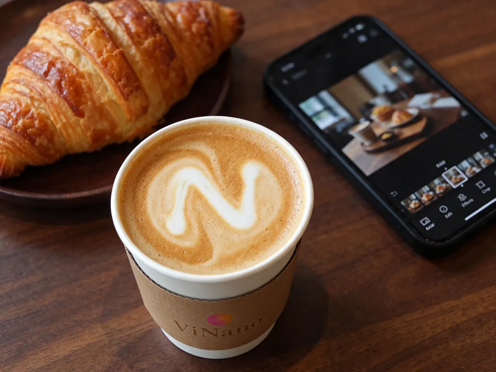

# Top-down food photo of a flat white

[← Back to the collection](../../README.md) · Category: [Food & Drink](../../gallery/food-drink.md) · Model: `Seedream 5.5` · ID: `vn-02102`

<a href="https://vinano.ai?utm_source=github&utm_medium=readme&utm_campaign=awesome-image-video-prompts-updating&utm_content=prompt-page-image"></a>

<sub>Preview generated with <a href="https://vinano.ai?utm_source=github&utm_medium=readme&utm_campaign=awesome-image-video-prompts-updating&utm_content=prompt-page-caption">vinano.ai</a> · added 2026-11-18</sub>

## Prompt

```text
Top-down food photo of a flat white on a walnut café table. The latte art in the milk foam forms a smooth flowing letter N. The paper cup sleeve is printed with the word "ViNano" and a small round pink-to-orange gradient logo. A butter croissant and a phone showing a photo editing app sit next to the cup. Soft window light, realistic textures.
```

## Try it on vinano.ai

1. Copy the prompt above.
2. Open **[vinano.ai](https://vinano.ai?utm_source=github&utm_medium=readme&utm_campaign=awesome-image-video-prompts-updating&utm_content=prompt-page-try)**, paste it into the image generator and pick a model.
3. Swap any placeholders (brand, product, city, person…) for your own details, then generate.

More prompts like this: [Food & Drink gallery](../../gallery/food-drink.md) · [all categories](../../README.md#contents)
