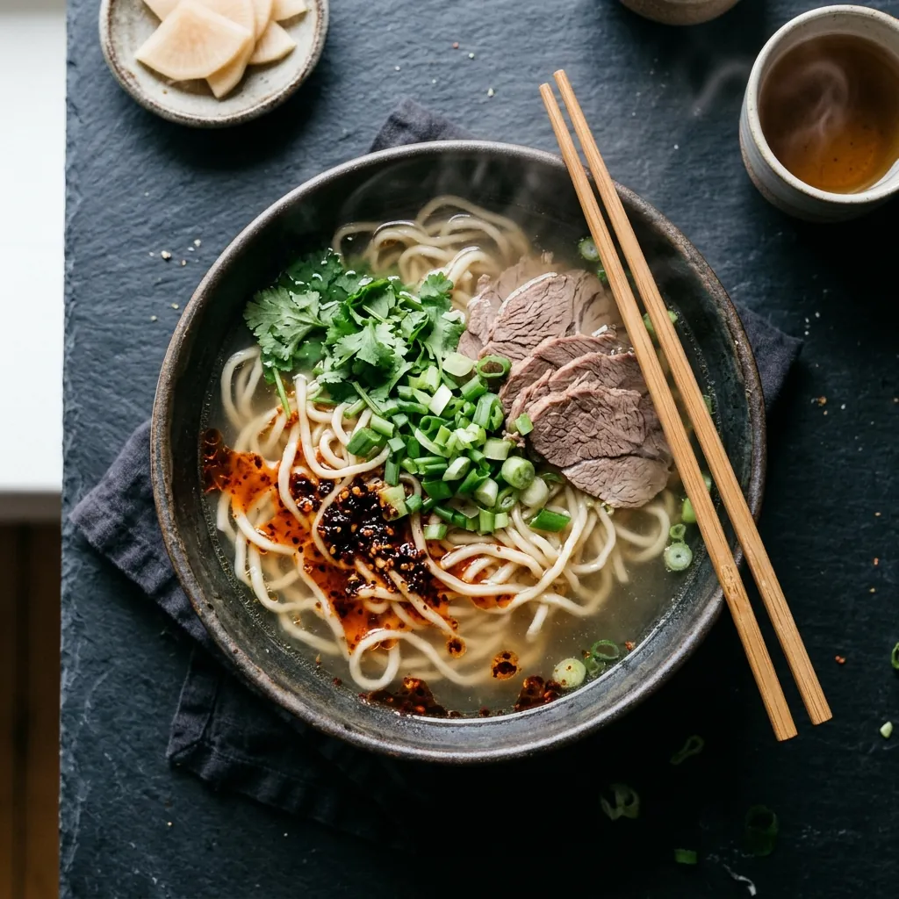

# Hand-Pulled Noodle Overhead

[← Back to the collection](../../README.md) · Category: [Food & Drink](../../gallery/food-drink.md) · Model: `Nano Banana 2.1` · ID: `vn-02142`

<a href="https://vinano.ai?utm_source=github&utm_medium=readme&utm_campaign=awesome-image-video-prompts-updating&utm_content=prompt-page-image"></a>

<sub>Preview generated with <a href="https://vinano.ai?utm_source=github&utm_medium=readme&utm_campaign=awesome-image-video-prompts-updating&utm_content=prompt-page-caption">vinano.ai</a> · added 2026-11-19</sub>

## Prompt

```text
Overhead food photograph of a ceramic bowl of hand-pulled beef noodles in clear broth, thin slices of beef, chopped scallions, cilantro and a spoonful of red chili oil spreading on the surface, chopsticks resting on the rim. Dark slate table, a small dish of pickled radish and a cup of tea at the edges, soft window light from the left, gentle steam, rich detail, editorial cookbook style.
```

## Try it on vinano.ai

1. Copy the prompt above.
2. Open **[vinano.ai](https://vinano.ai?utm_source=github&utm_medium=readme&utm_campaign=awesome-image-video-prompts-updating&utm_content=prompt-page-try)**, paste it into the image generator and pick a model.
3. Swap any placeholders (brand, product, city, person…) for your own details, then generate.

More prompts like this: [Food & Drink gallery](../../gallery/food-drink.md) · [all categories](../../README.md#contents)
