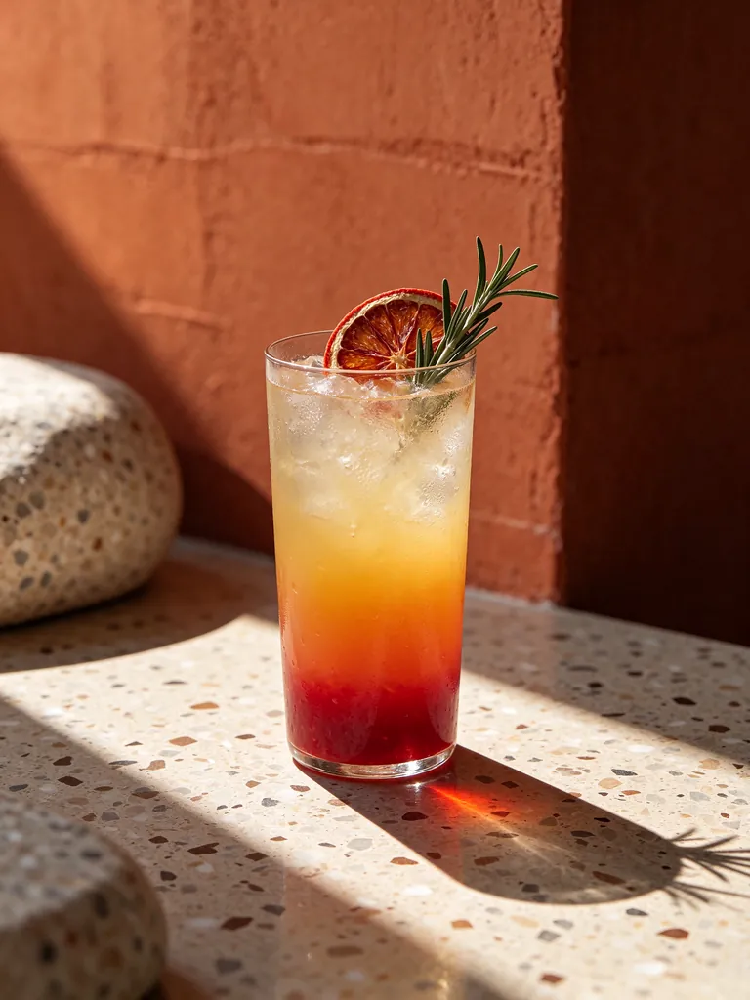

# Layered Citrus Mocktail

[← Back to the collection](../../README.md) · Category: [Food & Drink](../../gallery/food-drink.md) · Model: `Seedream 5.5` · ID: `vn-02143`

<a href="https://vinano.ai?utm_source=github&utm_medium=readme&utm_campaign=awesome-image-video-prompts-updating&utm_content=prompt-page-image"></a>

<sub>Preview generated with <a href="https://vinano.ai?utm_source=github&utm_medium=readme&utm_campaign=awesome-image-video-prompts-updating&utm_content=prompt-page-caption">vinano.ai</a> · added 2026-11-19</sub>

## Prompt

```text
A tall glass of layered blood-orange and yuzu mocktail with crushed ice, a dried orange wheel and a sprig of rosemary, condensation droplets on the glass. Placed on a terrazzo bar counter against a warm terracotta wall, hard late-afternoon sunlight casting a long colored shadow through the drink, minimal composition, high-end beverage advertising photo.
```

## Try it on vinano.ai

1. Copy the prompt above.
2. Open **[vinano.ai](https://vinano.ai?utm_source=github&utm_medium=readme&utm_campaign=awesome-image-video-prompts-updating&utm_content=prompt-page-try)**, paste it into the image generator and pick a model.
3. Swap any placeholders (brand, product, city, person…) for your own details, then generate.

More prompts like this: [Food & Drink gallery](../../gallery/food-drink.md) · [all categories](../../README.md#contents)
