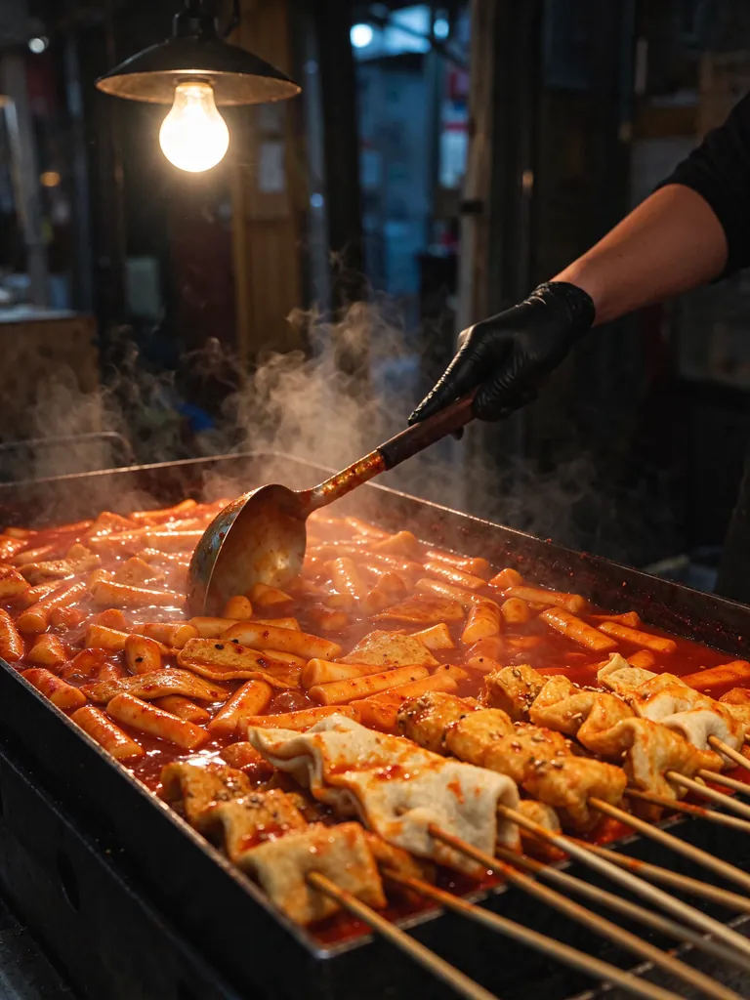

# Night Market Rice Cake Stall

[← Back to the collection](../../README.md) · Category: [Food & Drink](../../gallery/food-drink.md) · Model: `Seedream 5.5` · ID: `vn-02155`

<a href="https://vinano.ai?utm_source=github&utm_medium=readme&utm_campaign=awesome-image-video-prompts-updating&utm_content=prompt-page-image"></a>

<sub>Preview generated with <a href="https://vinano.ai?utm_source=github&utm_medium=readme&utm_campaign=awesome-image-video-prompts-updating&utm_content=prompt-page-caption">vinano.ai</a> · added 2026-11-23</sub>

## Prompt

```text
A night street-food scene: a wide shallow iron pan of glossy red spicy rice cakes and fish cakes bubbling in thick sauce under a bare bulb, steam rising, skewers of fried snacks lined up at the front, a vendor's gloved hand stirring with a long ladle. Shot at eye level with a 35mm lens, rich saturated reds and warm tungsten light against a dark blurred alley, droplets of sauce glistening, documentary food photography.
```

## Try it on vinano.ai

1. Copy the prompt above.
2. Open **[vinano.ai](https://vinano.ai?utm_source=github&utm_medium=readme&utm_campaign=awesome-image-video-prompts-updating&utm_content=prompt-page-try)**, paste it into the image generator and pick a model.
3. Swap any placeholders (brand, product, city, person…) for your own details, then generate.

More prompts like this: [Food & Drink gallery](../../gallery/food-drink.md) · [all categories](../../README.md#contents)
