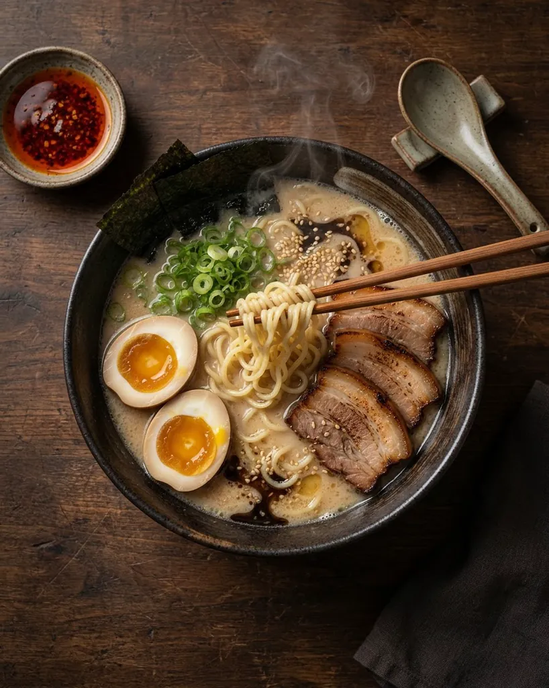

# Steaming Ramen Bowl Overhead

[← Back to the collection](../../README.md) · Category: [Food & Drink](../../gallery/food-drink.md) · Model: `Nano Banana 2.1` · ID: `vn-02164`

<a href="https://vinano.ai?utm_source=github&utm_medium=readme&utm_campaign=awesome-image-video-prompts-updating&utm_content=prompt-page-image"></a>

<sub>Preview generated with <a href="https://vinano.ai?utm_source=github&utm_medium=readme&utm_campaign=awesome-image-video-prompts-updating&utm_content=prompt-page-caption">vinano.ai</a> · added 2026-11-24</sub>

## Prompt

```text
Overhead food photograph of a bowl of tonkotsu-style ramen on a dark wooden counter: creamy broth, springy noodles lifted slightly with chopsticks, two halves of a jammy soft-boiled egg, slices of torched pork, nori sheets, scallions and sesame seeds. Thin wisps of steam, a small dish of chili oil and a ceramic spoon beside the bowl, moody low-key lighting with a single warm highlight, rich textures, shallow depth of field.
```

## Try it on vinano.ai

1. Copy the prompt above.
2. Open **[vinano.ai](https://vinano.ai?utm_source=github&utm_medium=readme&utm_campaign=awesome-image-video-prompts-updating&utm_content=prompt-page-try)**, paste it into the image generator and pick a model.
3. Swap any placeholders (brand, product, city, person…) for your own details, then generate.

More prompts like this: [Food & Drink gallery](../../gallery/food-drink.md) · [all categories](../../README.md#contents)
