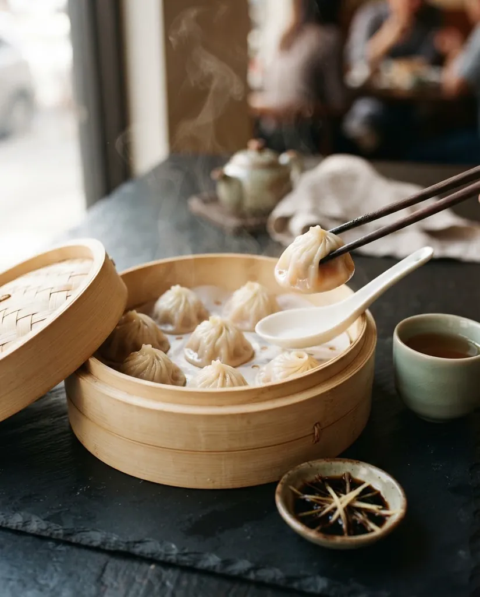

# Steamed Dumplings in Bamboo Basket

[← Back to the collection](../../README.md) · Category: [Food & Drink](../../gallery/food-drink.md) · Model: `Nano Banana 2.1` · ID: `vn-02174`

<a href="https://vinano.ai?utm_source=github&utm_medium=readme&utm_campaign=awesome-image-video-prompts-updating&utm_content=prompt-page-image"></a>

<sub>Preview generated with <a href="https://vinano.ai?utm_source=github&utm_medium=readme&utm_campaign=awesome-image-video-prompts-updating&utm_content=prompt-page-caption">vinano.ai</a> · added 2026-11-25</sub>

## Prompt

```text
A close three-quarter food photograph of a round bamboo steamer just opened, holding eight pleated soup dumplings on a sheet of parchment, thin wisps of steam rising and catching the light. One dumpling is lifted on dark wooden chopsticks above a small porcelain spoon, its skin slightly translucent. Beside the basket sit a tiny dish of black vinegar with fine ginger threads and a celadon teacup. Dark slate tabletop, soft window light from the left, shallow depth of field, glistening wet highlights on the wrappers, restaurant menu quality, appetizing and natural color.
```

## Try it on vinano.ai

1. Copy the prompt above.
2. Open **[vinano.ai](https://vinano.ai?utm_source=github&utm_medium=readme&utm_campaign=awesome-image-video-prompts-updating&utm_content=prompt-page-try)**, paste it into the image generator and pick a model.
3. Swap any placeholders (brand, product, city, person…) for your own details, then generate.

More prompts like this: [Food & Drink gallery](../../gallery/food-drink.md) · [all categories](../../README.md#contents)
