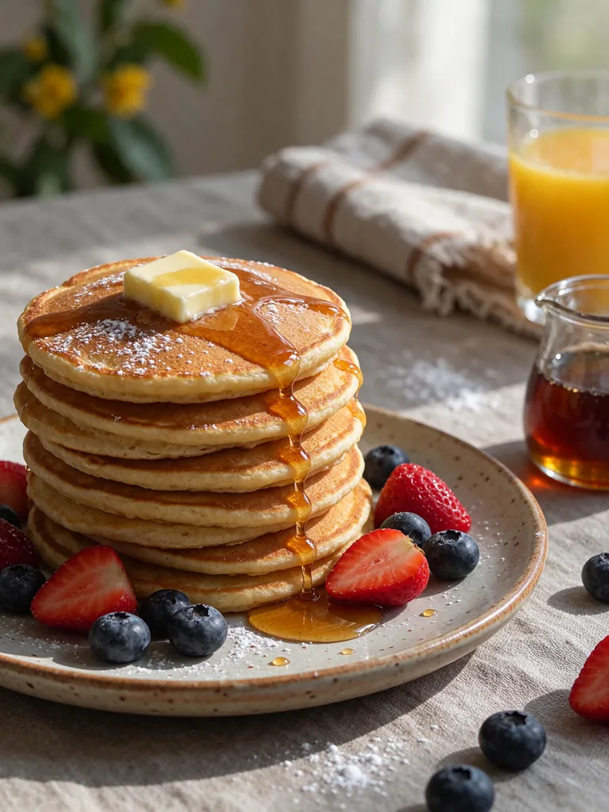

# Weekend Pancake Stack with Berries

[← Back to the collection](../../README.md) · Category: [Food & Drink](../../gallery/food-drink.md) · Model: `Seedream 5.5` · ID: `vn-02175`

<a href="https://vinano.ai?utm_source=github&utm_medium=readme&utm_campaign=awesome-image-video-prompts-updating&utm_content=prompt-page-image"></a>

<sub>Preview generated with <a href="https://vinano.ai?utm_source=github&utm_medium=readme&utm_campaign=awesome-image-video-prompts-updating&utm_content=prompt-page-caption">vinano.ai</a> · added 2026-11-25</sub>

## Prompt

```text
A tall stack of six fluffy golden pancakes on a speckled ceramic plate, a square of butter melting on top and a slow ribbon of maple syrup running down the side, frozen mid-drip. Fresh blueberries, halved strawberries and a dusting of powdered sugar are scattered over the stack and plate. In the background, softly blurred, a glass of orange juice, a small syrup jug and a linen napkin on a pale wooden table. Bright morning sunlight from a window on the right, gentle shadows, crisp detail on the pancake edges, cheerful weekend breakfast mood, editorial food photography.
```

## Try it on vinano.ai

1. Copy the prompt above.
2. Open **[vinano.ai](https://vinano.ai?utm_source=github&utm_medium=readme&utm_campaign=awesome-image-video-prompts-updating&utm_content=prompt-page-try)**, paste it into the image generator and pick a model.
3. Swap any placeholders (brand, product, city, person…) for your own details, then generate.

More prompts like this: [Food & Drink gallery](../../gallery/food-drink.md) · [all categories](../../README.md#contents)
