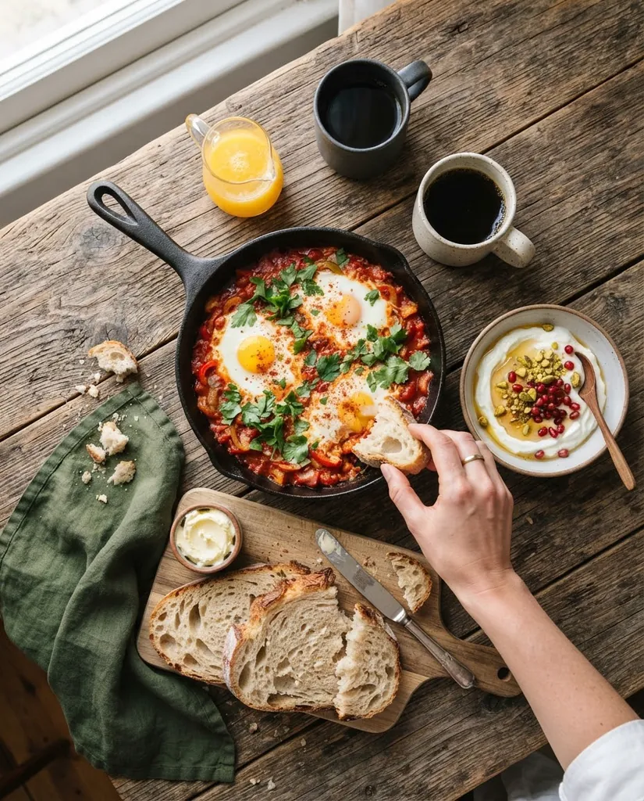

# Overhead Sunday Brunch Spread with Shakshuka

[← Back to the collection](../../README.md) · Category: [Food & Drink](../../gallery/food-drink.md) · Model: `Nano Banana 2.1` · ID: `vn-02184`

<a href="https://vinano.ai?utm_source=github&utm_medium=readme&utm_campaign=awesome-image-video-prompts-updating&utm_content=prompt-page-image"></a>

<sub>Preview generated with <a href="https://vinano.ai?utm_source=github&utm_medium=readme&utm_campaign=awesome-image-video-prompts-updating&utm_content=prompt-page-caption">vinano.ai</a> · added 2026-11-26</sub>

## Prompt

```text
Overhead food photograph of a rustic Sunday brunch spread on a weathered oak table: a cast-iron pan of shakshuka with three runny eggs and torn parsley, a board of sliced sourdough with whipped butter, a bowl of thick yogurt topped with honey, pistachios and pomegranate seeds, a small glass jug of fresh orange juice and two ceramic mugs of black coffee. Linen napkins, scattered crumbs, a hand reaching in with a piece of bread. Bright natural morning light from the top left, gentle shadows, warm and inviting colors, editorial cookbook style, sharp detail.
```

## Try it on vinano.ai

1. Copy the prompt above.
2. Open **[vinano.ai](https://vinano.ai?utm_source=github&utm_medium=readme&utm_campaign=awesome-image-video-prompts-updating&utm_content=prompt-page-try)**, paste it into the image generator and pick a model.
3. Swap any placeholders (brand, product, city, person…) for your own details, then generate.

More prompts like this: [Food & Drink gallery](../../gallery/food-drink.md) · [all categories](../../README.md#contents)
