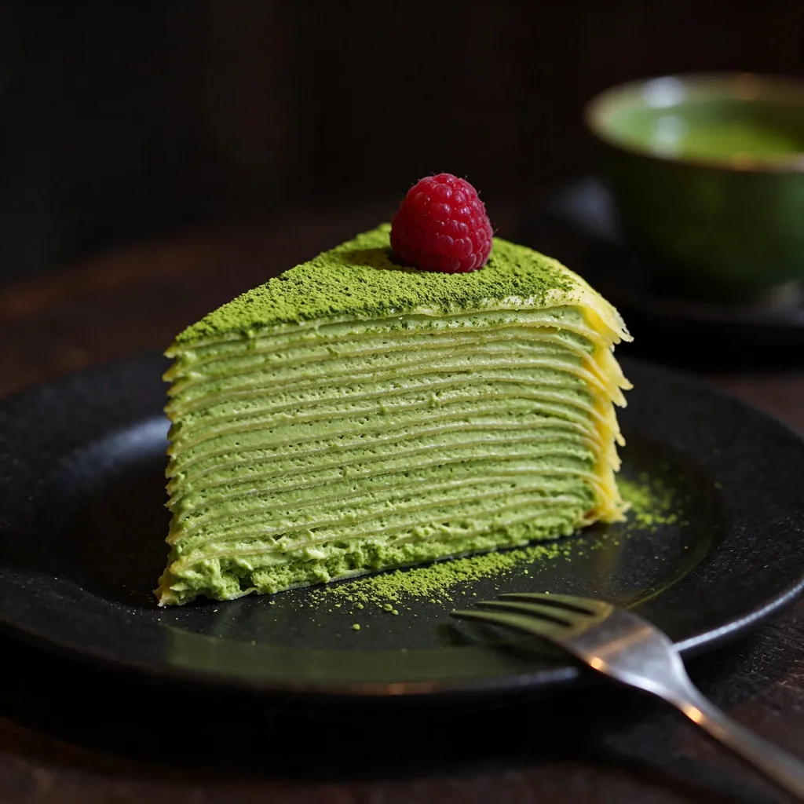

# Matcha Mille Crepe Cake Slice

[← Back to the collection](../../README.md) · Category: [Food & Drink](../../gallery/food-drink.md) · Model: `Seedream 5.5` · ID: `vn-02185`

<a href="https://vinano.ai?utm_source=github&utm_medium=readme&utm_campaign=awesome-image-video-prompts-updating&utm_content=prompt-page-image"></a>

<sub>Preview generated with <a href="https://vinano.ai?utm_source=github&utm_medium=readme&utm_campaign=awesome-image-video-prompts-updating&utm_content=prompt-page-caption">vinano.ai</a> · added 2026-11-26</sub>

## Prompt

```text
A glossy close-up of a single slice of matcha mille crepe cake on a matte black plate, twenty thin pale crepe layers alternating with light green cream clearly visible on the cut side, a dusting of bright matcha powder on top and one fresh raspberry. A small silver fork rests beside it and a cup of green tea blurs softly in the background. Low side light making the layers glow, dark moody backdrop, shallow depth of field, high-end patisserie menu photo.
```

## Try it on vinano.ai

1. Copy the prompt above.
2. Open **[vinano.ai](https://vinano.ai?utm_source=github&utm_medium=readme&utm_campaign=awesome-image-video-prompts-updating&utm_content=prompt-page-try)**, paste it into the image generator and pick a model.
3. Swap any placeholders (brand, product, city, person…) for your own details, then generate.

More prompts like this: [Food & Drink gallery](../../gallery/food-drink.md) · [all categories](../../README.md#contents)
