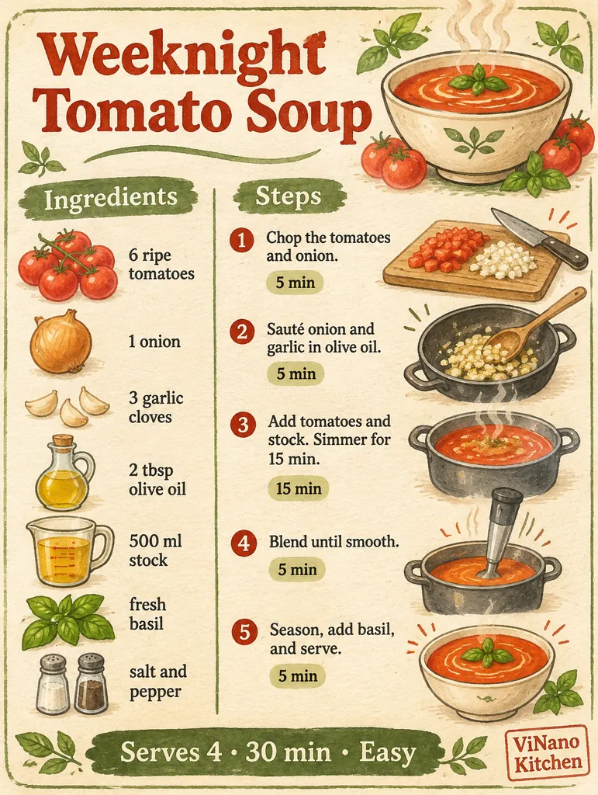

# Weeknight Tomato Soup Recipe Card

[← Back to the collection](../../README.md) · Category: [Food & Drink](../../gallery/food-drink.md) · Model: `GPT Image 2.6 Flare` · ID: `vn-02192`

<a href="https://vinano.ai?utm_source=github&utm_medium=readme&utm_campaign=awesome-image-video-prompts-updating&utm_content=prompt-page-image"></a>

<sub>Preview generated with <a href="https://vinano.ai?utm_source=github&utm_medium=readme&utm_campaign=awesome-image-video-prompts-updating&utm_content=prompt-page-caption">vinano.ai</a> · added 2026-11-27</sub>

## Prompt

```text
An illustrated recipe card infographic for "Weeknight Tomato Soup" in a warm hand-drawn style. Top: the title in a chunky serif with a steaming bowl illustration. Left column: an ingredient list with tiny watercolor icons (6 ripe tomatoes, 1 onion, 3 garlic cloves, 2 tbsp olive oil, 500 ml stock, fresh basil, salt and pepper). Right column: five numbered steps with small sketches of chopping, sauteing, simmering, blending and serving, each with a time label. Bottom strip: "Serves 4 · 30 min · Easy" and a small stamp reading "ViNano Kitchen". Cream paper texture, tomato red, olive green and charcoal ink, all text legible and correctly spelled.
```

## Try it on vinano.ai

1. Copy the prompt above.
2. Open **[vinano.ai](https://vinano.ai?utm_source=github&utm_medium=readme&utm_campaign=awesome-image-video-prompts-updating&utm_content=prompt-page-try)**, paste it into the image generator and pick a model.
3. Swap any placeholders (brand, product, city, person…) for your own details, then generate.

More prompts like this: [Food & Drink gallery](../../gallery/food-drink.md) · [all categories](../../README.md#contents)
