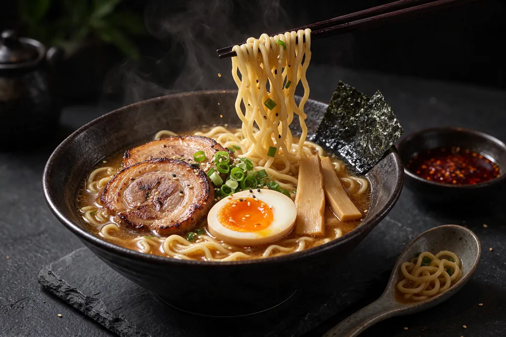

# Moody Miso Ramen Bowl

[← Back to the collection](../../README.md) · Category: [Food & Drink](../../gallery/food-drink.md) · Model: `Seedream 5.5` · ID: `vn-02194`

<a href="https://vinano.ai?utm_source=github&utm_medium=readme&utm_campaign=awesome-image-video-prompts-updating&utm_content=prompt-page-image"></a>

<sub>Preview generated with <a href="https://vinano.ai?utm_source=github&utm_medium=readme&utm_campaign=awesome-image-video-prompts-updating&utm_content=prompt-page-caption">vinano.ai</a> · added 2026-11-27</sub>

## Prompt

```text
Moody food photograph of a steaming bowl of rich miso ramen on a dark slate counter: thick wavy noodles, two slices of torched chashu pork, a halved soft egg with a jammy orange yolk, bamboo shoots, nori sheets, sliced scallions and a sprinkle of sesame seeds, chopsticks lifting a few noodles above the bowl. Wisps of steam caught in a warm side light, a small dish of chili oil and a ceramic spoon nearby, dark background, shallow depth of field, glossy broth, high-end restaurant menu style.
```

## Try it on vinano.ai

1. Copy the prompt above.
2. Open **[vinano.ai](https://vinano.ai?utm_source=github&utm_medium=readme&utm_campaign=awesome-image-video-prompts-updating&utm_content=prompt-page-try)**, paste it into the image generator and pick a model.
3. Swap any placeholders (brand, product, city, person…) for your own details, then generate.

More prompts like this: [Food & Drink gallery](../../gallery/food-drink.md) · [all categories](../../README.md#contents)
