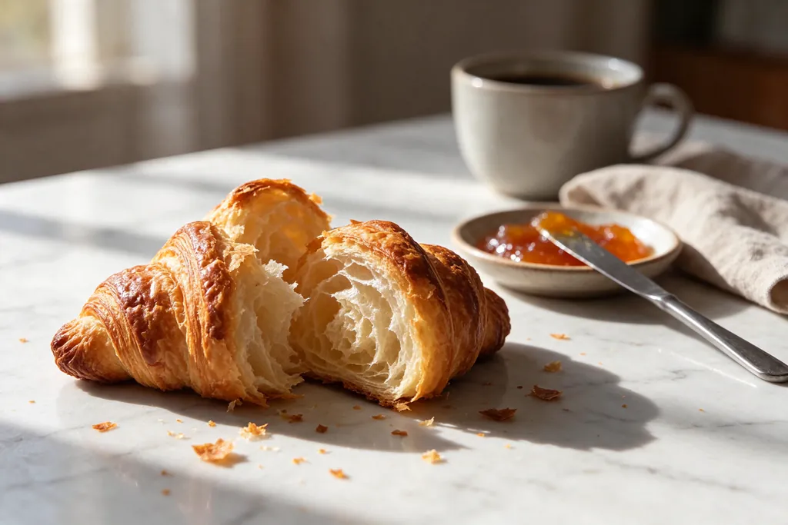

# Torn Croissant in Morning Light

[← Back to the collection](../../README.md) · Category: [Food & Drink](../../gallery/food-drink.md) · Model: `Seedream 5.5` · ID: `vn-02203`

<a href="https://vinano.ai?utm_source=github&utm_medium=readme&utm_campaign=awesome-image-video-prompts-updating&utm_content=prompt-page-image"></a>

<sub>Preview generated with <a href="https://vinano.ai?utm_source=github&utm_medium=readme&utm_campaign=awesome-image-video-prompts-updating&utm_content=prompt-page-caption">vinano.ai</a> · added 2026-11-28</sub>

## Prompt

```text
Close-up food photograph of a freshly baked croissant torn in half on a white marble counter, showing the airy honeycomb layers inside, golden flaky crust with scattered crumbs. Next to it a small dish of apricot jam with a butter knife, a linen napkin and a cup of black coffee slightly out of focus. Low morning sunlight from a window on the left casting long soft shadows, warm tones, shallow depth of field, bakery cookbook cover quality.
```

## Try it on vinano.ai

1. Copy the prompt above.
2. Open **[vinano.ai](https://vinano.ai?utm_source=github&utm_medium=readme&utm_campaign=awesome-image-video-prompts-updating&utm_content=prompt-page-try)**, paste it into the image generator and pick a model.
3. Swap any placeholders (brand, product, city, person…) for your own details, then generate.

More prompts like this: [Food & Drink gallery](../../gallery/food-drink.md) · [all categories](../../README.md#contents)
