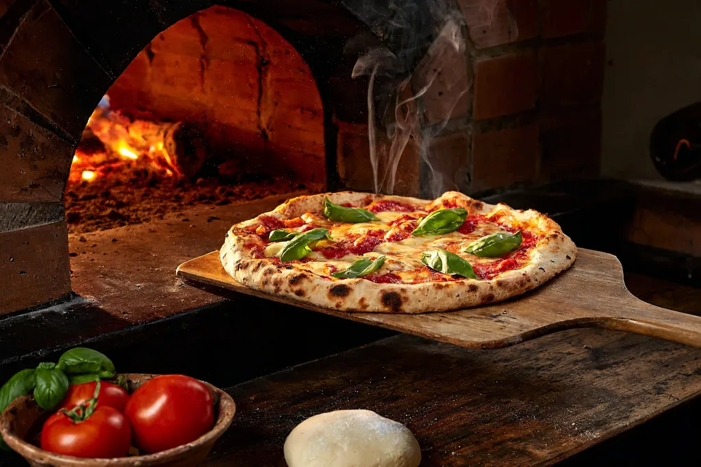

# Wood-Fired Pizza Leaving the Oven

[← Back to the collection](../../README.md) · Category: [Food & Drink](../../gallery/food-drink.md) · Model: `MiniMax H3 Image` · ID: `vn-02204`

<a href="https://vinano.ai?utm_source=github&utm_medium=readme&utm_campaign=awesome-image-video-prompts-updating&utm_content=prompt-page-image"></a>

<sub>Preview generated with <a href="https://vinano.ai?utm_source=github&utm_medium=readme&utm_campaign=awesome-image-video-prompts-updating&utm_content=prompt-page-caption">vinano.ai</a> · added 2026-11-28</sub>

## Prompt

```text
Action food photograph of a blistered Neapolitan-style pizza sliding out of a glowing wood-fired brick oven on a long wooden peel. Leopard-spotted puffy crust, bubbling mozzarella, bright tomato sauce and fresh basil leaves, a thin trail of steam. Orange flames and embers glow deep inside the oven, a dusting of flour hangs in the air, the foreground counter shows a bowl of tomatoes and a ball of dough. Warm firelight, dark rustic kitchen, sharp focus on the pizza, appetizing editorial style.
```

## Try it on vinano.ai

1. Copy the prompt above.
2. Open **[vinano.ai](https://vinano.ai?utm_source=github&utm_medium=readme&utm_campaign=awesome-image-video-prompts-updating&utm_content=prompt-page-try)**, paste it into the image generator and pick a model.
3. Swap any placeholders (brand, product, city, person…) for your own details, then generate.

More prompts like this: [Food & Drink gallery](../../gallery/food-drink.md) · [all categories](../../README.md#contents)
