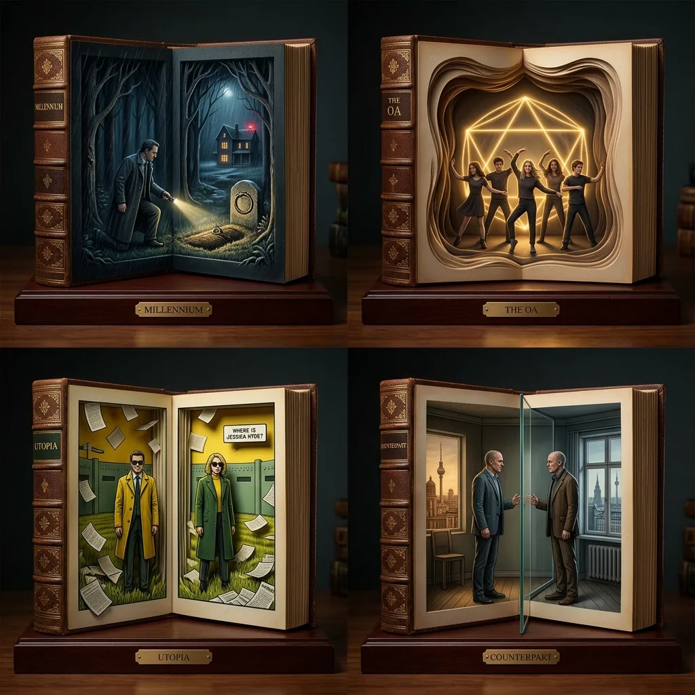

# Illustration & 3D prompt #20

[← Back to the collection](../../README.md) · Category: [Illustration & 3D](../../gallery/illustration-3d.md) · Model: `Vinano Image Pro` · ID: `vn-00020`

<a href="https://vinano.ai?utm_source=github&utm_medium=readme&utm_campaign=awesome-image-video-prompts-updating&utm_content=prompt-page-image"></a>

<sub>Preview generated with <a href="https://vinano.ai?utm_source=github&utm_medium=readme&utm_campaign=awesome-image-video-prompts-updating&utm_content=prompt-page-caption">vinano.ai</a></sub>

## Prompt

```text
function recommend(x) { Determine type(x) (e.g. game, movie, book, or TV series) Role: world-class TV, book and movie expert Analyze x's style, storyline, tone, every aspect and find 4 hidden gems in type (x) {} return: 2x2 grid carved book-block dioramas, each grid antique leather-bound books hollowed and carved, warm reading-lamp glow from within, dark mahogany bases, ultra-realistic} draw(recommend (X -Files); Maintain consistent colour harmony and crisp focus across the whole frame.
```

## Try it on vinano.ai

1. Copy the prompt above.
2. Open **[vinano.ai](https://vinano.ai?utm_source=github&utm_medium=readme&utm_campaign=awesome-image-video-prompts-updating&utm_content=prompt-page-try)**, paste it into the image generator and pick a model.
3. Swap any placeholders (brand, product, city, person…) for your own details, then generate.

More prompts like this: [Illustration & 3D gallery](../../gallery/illustration-3d.md) · [all categories](../../README.md#contents)
