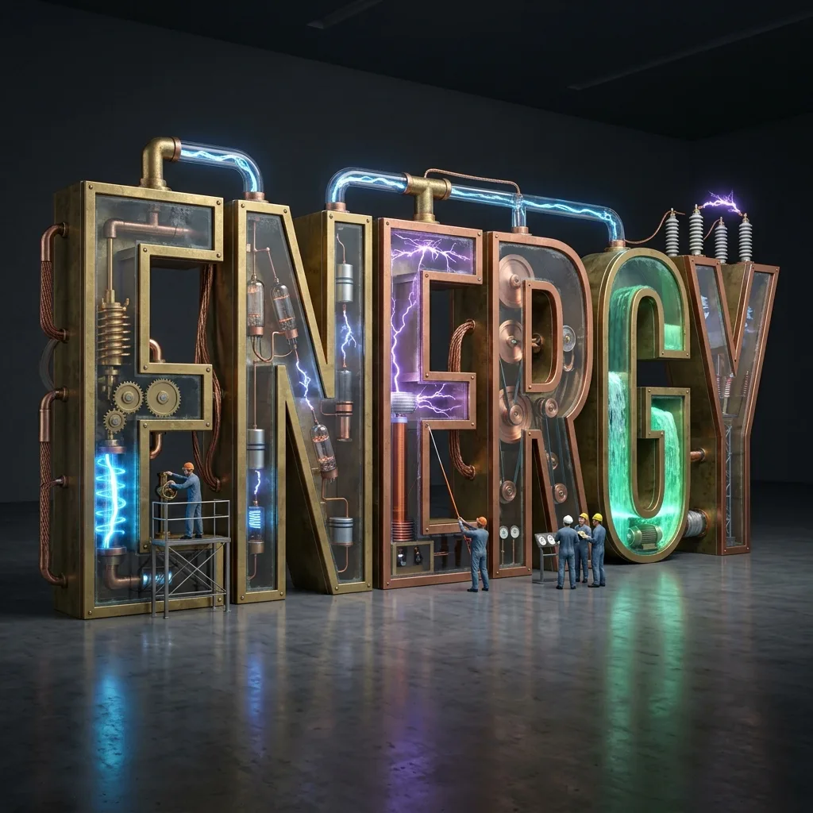

# 3D typography render where the letters are constructed

[← Back to the collection](../../README.md) · Category: [Illustration & 3D](../../gallery/illustration-3d.md) · Model: `Vinano Image Pro` · ID: `vn-00026`

<a href="https://vinano.ai?utm_source=github&utm_medium=readme&utm_campaign=awesome-image-video-prompts-updating&utm_content=prompt-page-image"></a>

<sub>Preview generated with <a href="https://vinano.ai?utm_source=github&utm_medium=readme&utm_campaign=awesome-image-video-prompts-updating&utm_content=prompt-page-caption">vinano.ai</a></sub>

## Prompt

```text
<instructions>
Input word or concept
Act as a Conceptual Sculptor. Generate a 3D typography render where the letters are constructed from materials that Physically Embody the Input Word.
1. Material & Physics Inference (The DNA):
Analyze the Input Word to determine the Structural Material and Internal Physics:
If Ethereal (e.g., TIME, SOUL): Use Glass, Brass, and Light. Physics = Flowing, ticking, glowing.
If Elemental (e.g., FIRE, MAGMA): Use Black Iron cages. Physics = Burning, dripping, smoking.
If Organic (e.g., GROWTH, LIFE): Use Wooden frames or Terrarium glass. Physics = Growing, blooming, condensation.
If Industrial (e.g., FACTORY, STEEL): Use Rusted Steel beams. Physics = Grinding gears, steam vents.
2. Container:
The Structure: The letters are massive, 3D structural frames.
The Transparency: The front face is open or transparent to reveal the Internal Mechanism.
The Logic: The frame must look like it was built to contain the specific substance inside (e.g., thick glass for gas; heavy iron for magma).
3. The Internal Mechanism:
Content: Fill the hollow letters the active element of the concept.
Example (TIME): Sand pouring from T to I; Pendulums swinging in M; Gears turning in E.
Example (FIRE): Real flames licking up the inside of F; Coals glowing in I; Smoke venting from R.
Connectivity: Pipes, wires, or vines connect the letters, transferring the energy from one to the next.
4. The Narrative Scale:
The Figures: Tiny 1:87 scale figures interact the letters.
Inference: If "TIME," figures are winding clocks. If "FIRE," figures are stokers shoveling coal. If "GROWTH," figures are gardeners watering plants.
5. Lighting & Atmosphere:
Source: The light comes from the Material itself (e.g., Fire glow, Bioluminescence, Neon).
Environment: The table/floor matches the theme (e.g., Burnt wood for FIRE; Mossy earth for GROWTH).
Output: ONE image, High Resolution 3D Render, Conceptual Art Aesthetic.
</instructions>

Keep edges clean and the overall composition balanced for a polished, gallery-ready result.
```

## Try it on vinano.ai

1. Copy the prompt above.
2. Open **[vinano.ai](https://vinano.ai?utm_source=github&utm_medium=readme&utm_campaign=awesome-image-video-prompts-updating&utm_content=prompt-page-try)**, paste it into the image generator and pick a model.
3. Swap any placeholders (brand, product, city, person…) for your own details, then generate.

More prompts like this: [Illustration & 3D gallery](../../gallery/illustration-3d.md) · [all categories](../../README.md#contents)
