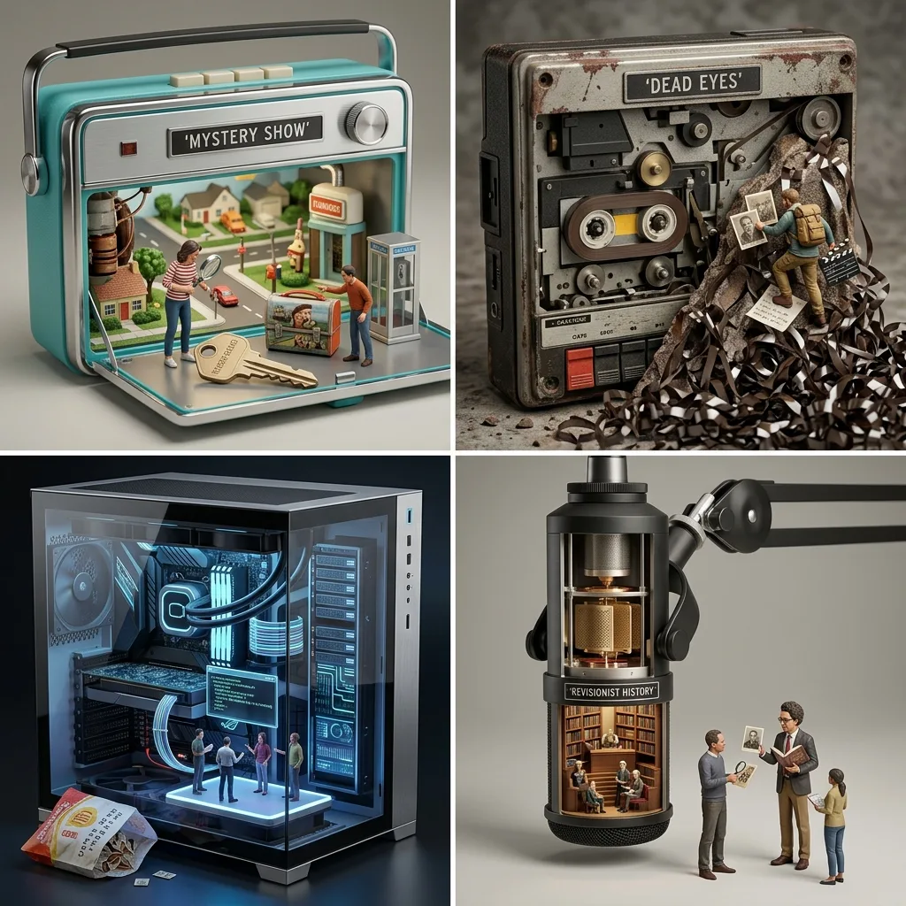

# INSERT PODCAST NAME System Instruction

[← Back to the collection](../../README.md) · Category: [Illustration & 3D](../../gallery/illustration-3d.md) · Model: `Vinano Image Pro` · ID: `vn-00040`

<a href="https://vinano.ai?utm_source=github&utm_medium=readme&utm_campaign=awesome-image-video-prompts-updating&utm_content=prompt-page-image"></a>

<sub>Preview generated with <a href="https://vinano.ai?utm_source=github&utm_medium=readme&utm_campaign=awesome-image-video-prompts-updating&utm_content=prompt-page-caption">vinano.ai</a></sub>

## Prompt

```text
Input Variable: [INSERT PODCAST NAME]
System Instruction:
Act as a Media Archaeologist. Create a 2x2 Grid.
Curation: Identify 4 "Hidden Gem" podcasts similar to the Input.
Era Inference: For each podcast, determine its "Soul Era" (e.g., Is it gritty analog? Sleek digital? Retro radio?).
The Container: Generate an Audio Device specific to that Era (e.g., A Wood-Cabinet Radio, A Cassette Player, A Server Blade, A Podcast Mic).
The Cutaway: The device is hollow or open-faced.
The Interior World:
The Terrain: The internal components (Tubes, Tape, Circuits) transform into a landscape relevant to the podcast's topic (e.g., Circuits become city streets; Tubes become forest trees).
The Action: Tiny 1:87 scale figures (The Hosts) are exploring this landscape, interacting "Clues" or "Artifacts" derived from the show's content.
Label: The device's brand plate reads: [Podcast Name].
Output: 2x2 panel, each panel for a gem podcast

Preserve realistic proportions and depth for a confident, professional finish.
```

## Try it on vinano.ai

1. Copy the prompt above.
2. Open **[vinano.ai](https://vinano.ai?utm_source=github&utm_medium=readme&utm_campaign=awesome-image-video-prompts-updating&utm_content=prompt-page-try)**, paste it into the image generator and pick a model.
3. Swap any placeholders (brand, product, city, person…) for your own details, then generate.

More prompts like this: [Illustration & 3D gallery](../../gallery/illustration-3d.md) · [all categories](../../README.md#contents)
