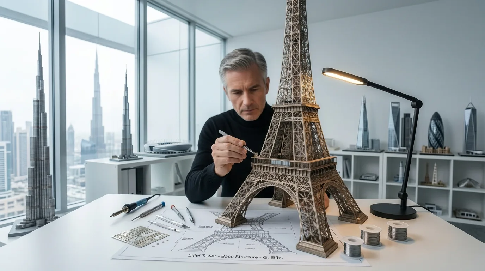

# INSERT STRUCTURE System Instruction

[← Back to the collection](../../README.md) · Category: [Illustration & 3D](../../gallery/illustration-3d.md) · Model: `Vinano Image Pro` · ID: `vn-00047`

<a href="https://vinano.ai?utm_source=github&utm_medium=readme&utm_campaign=awesome-image-video-prompts-updating&utm_content=prompt-page-image"></a>

<sub>Preview generated with <a href="https://vinano.ai?utm_source=github&utm_medium=readme&utm_campaign=awesome-image-video-prompts-updating&utm_content=prompt-page-caption">vinano.ai</a></sub>

## Prompt

```text
Do this for Eiffel Tower:

Input Variable: [INSERT STRUCTURE]
System Instruction:
Act as a Cinematic Director. Create a hyper-realistic portrait of a Master Model Maker putting the final touches on a scale replica of the Input Structure.
1. Logic:
Analyze the Input Structure to determine the Setting and the Character:
IF Ancient/Fantasy (e.g., Colosseum, Castle):
Room: A dusty, sunlit Renaissance Workshop (Stone & Wood). also showcasing "Previous Projects" (other models in the same genre).
Character: An elderly Artisan in a leather apron.
Materials: Plaster, Clay, Balsam Wood.
IF Sci-Fi/Industrial (e.g., Death Star, spaceship):
Room: A sterile, cold Industrial Design Lab (Concrete & Metal). also showcasing "Previous Projects" (other models in the same genre).
Character: A younger Prop Master in a workshop jumpsuit or lab coat.
Materials: Grey Resin (Kitbash), Styrene, Fiber Optics.
IF Modern Architecture (e.g., Skyscraper):
Room: A clean, white Architectural Firm (Glass & White Walls). also showcasing "Previous Projects" (other models in the same genre).
Character: A refined minimalist Architect in a black turtleneck.
Materials: White Foamcore, Acrylic, 3D Printed Plastic.
2. The Composition:
The Subject: The Character is leaning over a massive, incredibly detailed Scale Model of the Input Structure.
The Action: They are Tweezers or a fine brush to place a specific "Micro-Detail" relevant to the lore.
Death Star: Placing a tiny Turbo-Laser Turret.
Colosseum: Dusting sand onto the arena floor.
City: Gluing a tiny streetlamp.
The Scale: Extreme scale contrast. The human hands look giant next to the tiny windows/bricks of the model.
3. The Environment:
The Blueprint: On the table, beneath the tools, lies the correct reference document:
Sci-Fi: Blue grid schematic or iPad.
Fantasy: Yellowed parchment map.
Modern: White vector floorplan.
The Clutter: The tools scattered around must match the medium (e.g., Clay tools vs. Soldering Iron vs. X-Acto knives).
4. Lighting & Atmosphere:
Lighting Match: The lighting must match the inferred room.
Workshop: Warm God Rays (Dusty).
Lab: Cool Fluorescent Tubes (Clean/Hazy).
Focus: Shallow depth of field. Sharp focus on the tweezers and the contact point.
Output: ONE image, 16:9 Aspect Ratio, Cinematic Photography, 8k Resolution.

Maintain consistent colour harmony and crisp focus across the whole frame.
```

## Try it on vinano.ai

1. Copy the prompt above.
2. Open **[vinano.ai](https://vinano.ai?utm_source=github&utm_medium=readme&utm_campaign=awesome-image-video-prompts-updating&utm_content=prompt-page-try)**, paste it into the image generator and pick a model.
3. Swap any placeholders (brand, product, city, person…) for your own details, then generate.

More prompts like this: [Illustration & 3D gallery](../../gallery/illustration-3d.md) · [all categories](../../README.md#contents)
