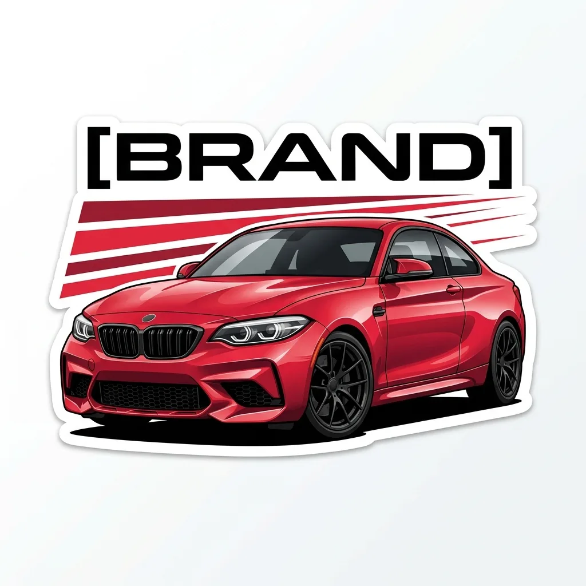

# Premium-quality vector art illustration of a COLOR BRAND +

[← Back to the collection](../../README.md) · Category: [Illustration & 3D](../../gallery/illustration-3d.md) · Model: `Vinano Image` · ID: `vn-00053`

<a href="https://vinano.ai?utm_source=github&utm_medium=readme&utm_campaign=awesome-image-video-prompts-updating&utm_content=prompt-page-image"></a>

<sub>Preview generated with <a href="https://vinano.ai?utm_source=github&utm_medium=readme&utm_campaign=awesome-image-video-prompts-updating&utm_content=prompt-page-caption">vinano.ai</a></sub>

## Prompt

```text
Create a premium-quality vector art illustration of a [COLOR] [BRAND + MODEL] viewed from a dynamic front-side angle, a modern car sticker design. The car should have detailed shading, black sport rims, and a glossy finish that reflects light. Add the text “[BRAND]” above the car in bold, modern font. Behind the car and text, include angled [STRIPE COLOR] stripes as a background element to add motion and energy. Use a white outline around the entire composition to give the sticker a cutout effect, just like a real die-cut sticker. Place the entire design on a plain white background to mimic how a sticker would appear. The overall design should be sporty, vibrant, and clean. Format: 1080x1080 pixels Render with rich micro-detail while keeping the layout uncluttered and intentional.
```

## Try it on vinano.ai

1. Copy the prompt above.
2. Open **[vinano.ai](https://vinano.ai?utm_source=github&utm_medium=readme&utm_campaign=awesome-image-video-prompts-updating&utm_content=prompt-page-try)**, paste it into the image generator and pick a model.
3. Swap any placeholders (brand, product, city, person…) for your own details, then generate.

More prompts like this: [Illustration & 3D gallery](../../gallery/illustration-3d.md) · [all categories](../../README.md#contents)
