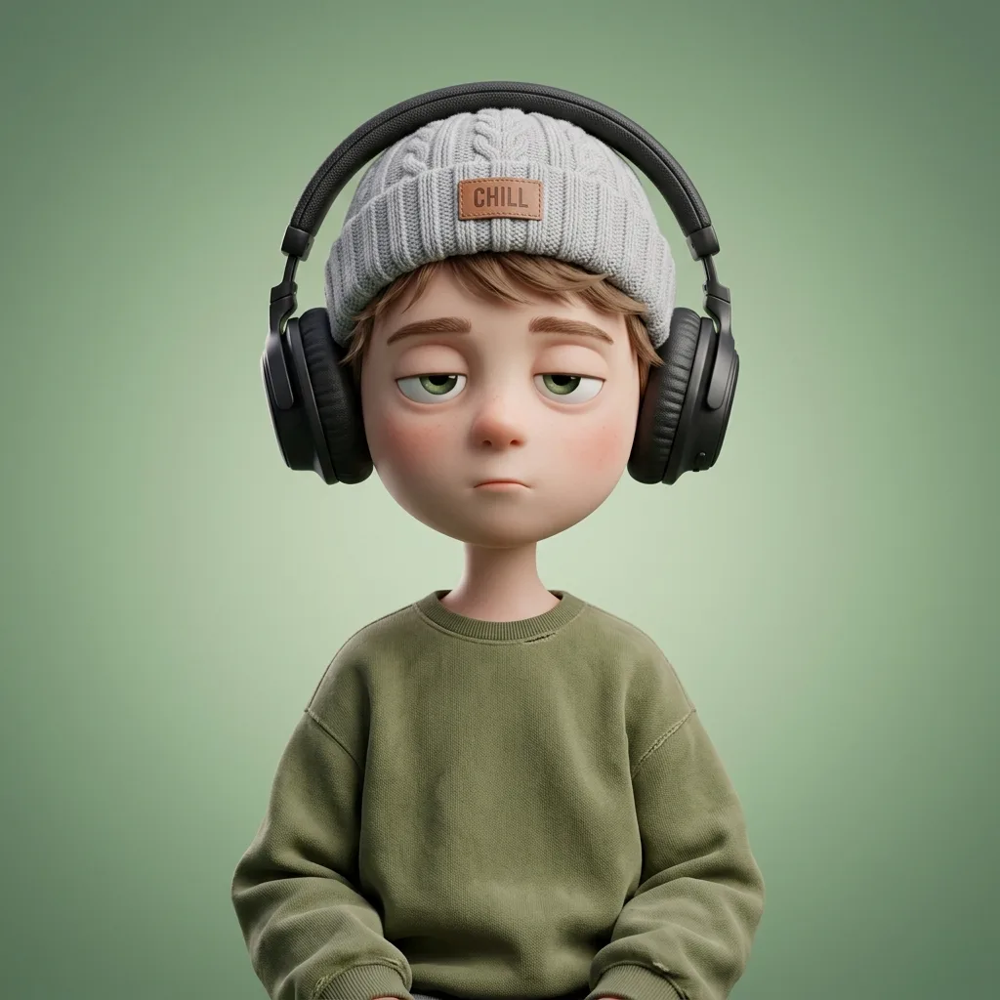

# Stylized 3D cartoon boy character a minimal, Pixar-like design

[← Back to the collection](../../README.md) · Category: [Illustration & 3D](../../gallery/illustration-3d.md) · Model: `Vinano Image v2` · ID: `vn-00054`

<a href="https://vinano.ai?utm_source=github&utm_medium=readme&utm_campaign=awesome-image-video-prompts-updating&utm_content=prompt-page-image"></a>

<sub>Preview generated with <a href="https://vinano.ai?utm_source=github&utm_medium=readme&utm_campaign=awesome-image-video-prompts-updating&utm_content=prompt-page-caption">vinano.ai</a></sub>

## Prompt

```text
A stylized 3D cartoon boy character a minimal, Pixar-like design, pale skin, slightly oversized head, and a slim body. He has half-closed sleepy green eyes, a bored expression, and soft facial features a small nose and subtle blush. He is wearing a light grey knitted beanie a small front label, large black over-ear headphones, and a loose green sweatshirt. The character is centered, facing forward, relaxed posture. Background is a smooth solid green gradient. Soft studio lighting, high detail, clean render, shallow depth of field, ultra-realistic textures, 4K. Emphasise material texture and natural light so the final frame feels tactile and premium.
```

## Try it on vinano.ai

1. Copy the prompt above.
2. Open **[vinano.ai](https://vinano.ai?utm_source=github&utm_medium=readme&utm_campaign=awesome-image-video-prompts-updating&utm_content=prompt-page-try)**, paste it into the image generator and pick a model.
3. Swap any placeholders (brand, product, city, person…) for your own details, then generate.

More prompts like this: [Illustration & 3D gallery](../../gallery/illustration-3d.md) · [all categories](../../README.md#contents)
