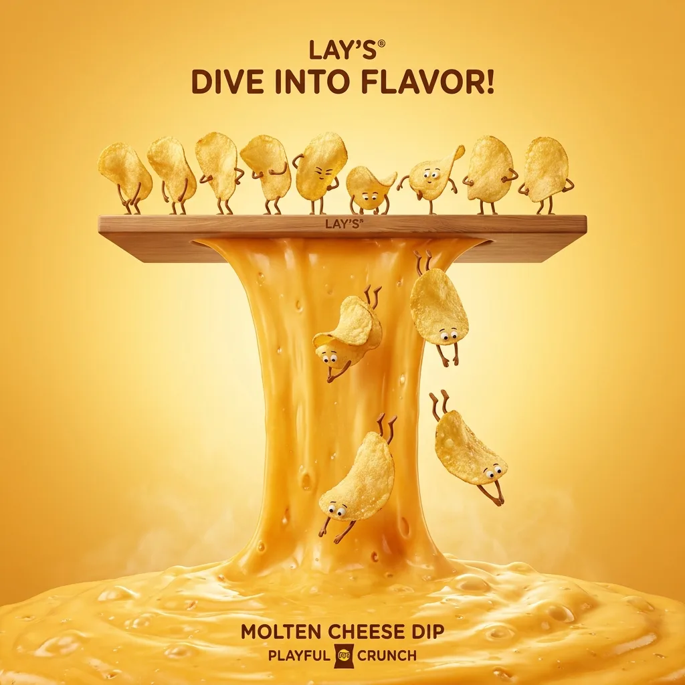

# Vertical snack advertising visual playful anthropomorphic tone

[← Back to the collection](../../README.md) · Category: [Illustration & 3D](../../gallery/illustration-3d.md) · Model: `Vinano Image v2` · ID: `vn-00070`

<a href="https://vinano.ai?utm_source=github&utm_medium=readme&utm_campaign=awesome-image-video-prompts-updating&utm_content=prompt-page-image"></a>

<sub>Preview generated with <a href="https://vinano.ai?utm_source=github&utm_medium=readme&utm_campaign=awesome-image-video-prompts-updating&utm_content=prompt-page-caption">vinano.ai</a></sub>

## Prompt

```text
Vertical snack advertising visual playful anthropomorphic tone. At the top, golden Lay’s potato chips arranged in a neat vertical queue, each chip posed like a diver on a diving platform, some slightly bent forward, some mid-tilt, suggesting preparation and focus before jumping. Below them, thick molten cheese flowing downward, glossy and stretchy, forming a rich cheese lava pool at the bottom. Several chips are frozen mid-air in clean diving poses, angled downward like synchronized divers, capturing a precise pre-splash moment. Warm yellow and cheese-orange gradient background, studio advertising lighting, soft highlights, refined shadows. Strong central axis composition, clear visual hierarchy. refined minimalist graphic layout, fun yet premium commercial food photography aesthetic, ultra-detailed textures, hyper-realistic, 8K resolution. Aim for an editorial, design-driven look with deliberate negative space.
```

## Try it on vinano.ai

1. Copy the prompt above.
2. Open **[vinano.ai](https://vinano.ai?utm_source=github&utm_medium=readme&utm_campaign=awesome-image-video-prompts-updating&utm_content=prompt-page-try)**, paste it into the image generator and pick a model.
3. Swap any placeholders (brand, product, city, person…) for your own details, then generate.

More prompts like this: [Illustration & 3D gallery](../../gallery/illustration-3d.md) · [all categories](../../README.md#contents)
