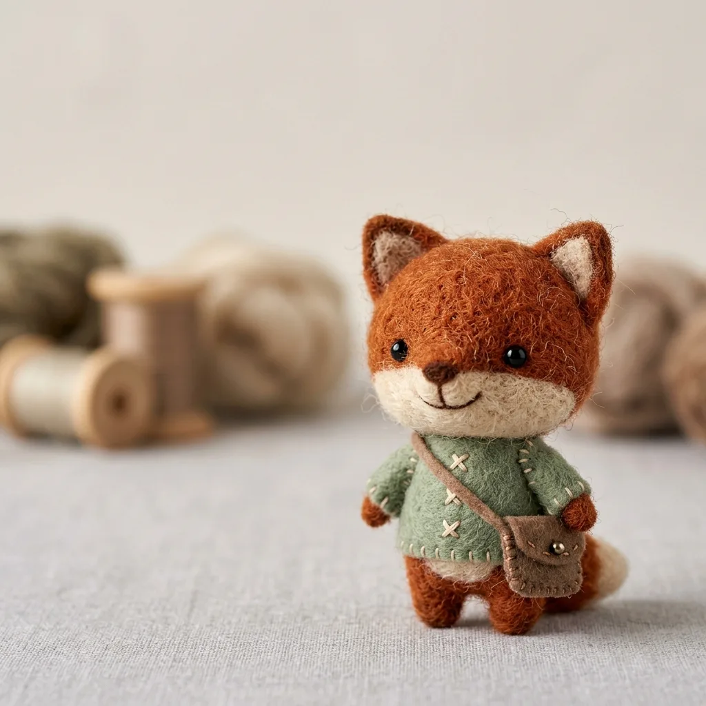

# Target style

[← Back to the collection](../../README.md) · Category: [Illustration & 3D](../../gallery/illustration-3d.md) · Model: `Vinano Image v2` · ID: `vn-00074`

<a href="https://vinano.ai?utm_source=github&utm_medium=readme&utm_campaign=awesome-image-video-prompts-updating&utm_content=prompt-page-image"></a>

<sub>Preview generated with <a href="https://vinano.ai?utm_source=github&utm_medium=readme&utm_campaign=awesome-image-video-prompts-updating&utm_content=prompt-page-caption">vinano.ai</a></sub>

## Prompt

```text
{
  "target_style": "Handcrafted needle-felted wool miniature",
  "texture_properties": {
    "material": "organic roving wool, fuzzy fibers, soft tactile felt",
    "details": "visible needle-punch textures, soft fuzzy surface, handcrafted seams",
    "eyes": "small black bead eyes or simple felted circles"
  },
  "adaptation_rules": {
    "proportions": "stylized, slightly oversized head, simplified limbs, cute aesthetic",
    "color_palette": "retain original colors from source image but soften wool texture",
    "clothing": "simplified felt versions of the original outfits, tiny fabric buttons, stitched details",
    "accessories": "replicate key items from source as miniature felted props"
  },
  "environment": {
    "camera": "macro photography, close-up shot",
    "lighting": "soft studio lighting, warm highlights, gentle shadows",
    "background": "clean, out-of-focus bokeh background, neutral craft studio setting",
    "depth_of_field": "shallow depth of field (f/2.8)"
  },
  "rendering_engine_hints": "high fidelity, 8k, true-to-life photorealistic wool texture, Pixar-like character charm"
}

Aim for an editorial, design-driven look with deliberate negative space.
```

## Try it on vinano.ai

1. Copy the prompt above.
2. Open **[vinano.ai](https://vinano.ai?utm_source=github&utm_medium=readme&utm_campaign=awesome-image-video-prompts-updating&utm_content=prompt-page-try)**, paste it into the image generator and pick a model.
3. Swap any placeholders (brand, product, city, person…) for your own details, then generate.

More prompts like this: [Illustration & 3D gallery](../../gallery/illustration-3d.md) · [all categories](../../README.md#contents)
