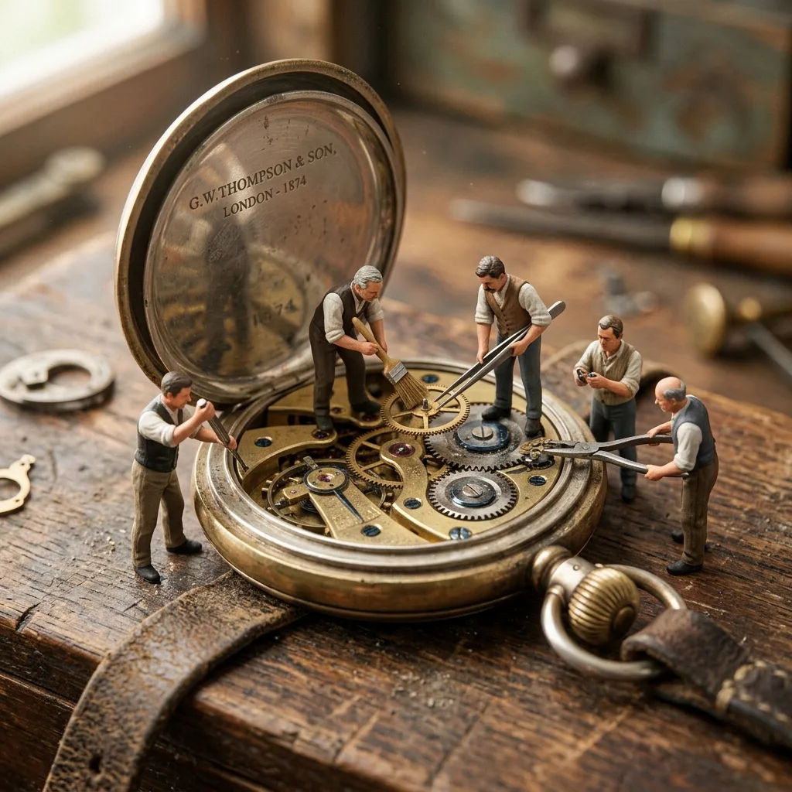

# Macro scene depicting tiny restoration workers collaboratively repairing

[← Back to the collection](../../README.md) · Category: [Illustration & 3D](../../gallery/illustration-3d.md) · Model: `Vinano Image v2` · ID: `vn-00092`

<a href="https://vinano.ai?utm_source=github&utm_medium=readme&utm_campaign=awesome-image-video-prompts-updating&utm_content=prompt-page-image"></a>

<sub>Preview generated with <a href="https://vinano.ai?utm_source=github&utm_medium=readme&utm_campaign=awesome-image-video-prompts-updating&utm_content=prompt-page-caption">vinano.ai</a></sub>

## Prompt

```text
Ultra-realistic macro scene depicting tiny restoration workers collaboratively repairing an antique pocket watch. Several figures delicately clean intricate brass gears fine brushes, while others stabilize the open watch casing and hold miniature components in place. The pocket watch lies on a textured natural surface, such as weathered wood or stone, emphasizing age and history. The scene symbolizes time, patience, craftsmanship, and teamwork.",
 "style": {
 "photography_type": "Macro photography",
 "realism": "Ultra-realistic",
 "mood": "Emotional and cinematic",
 "lighting": "Soft, warm, directional lighting gentle highlights and natural shadows",
 "depth_of_field": "Shallow depth of field sharp focus on foreground details and smooth background bokeh"
 },
 "composition": {
 "shot_type": "Close-up macro",
 "angle": "Slightly elevated perspective",
 "focus": "Extreme detail on gears, tools, and figurines’ interactions",
 "framing": "Pocket watch centered workers distributed naturally across the mechanism"
 },
 "textures_and_details": {
 "materials": "Aged metal, polished brass gears, worn leather strap, natural surface grain",
 "details": "Visible dust particles, subtle scratches, fingerprints, and mechanical wear"
 },
 "atmosphere": {
 "tone": "Warm, nostalgic, hopeful",
 "symbolism": "Restoration of time through collective effort and care"
 },
 "render_settings": {
 "aspect_ratio": "4:5",
 "quality": 2,
 "resolution": "High-resolution",
 "style_precision": "Professional studio-level composition"
 }
}

Maintain consistent colour harmony and crisp focus across the whole frame.
```

## Try it on vinano.ai

1. Copy the prompt above.
2. Open **[vinano.ai](https://vinano.ai?utm_source=github&utm_medium=readme&utm_campaign=awesome-image-video-prompts-updating&utm_content=prompt-page-try)**, paste it into the image generator and pick a model.
3. Swap any placeholders (brand, product, city, person…) for your own details, then generate.

More prompts like this: [Illustration & 3D gallery](../../gallery/illustration-3d.md) · [all categories](../../README.md#contents)
