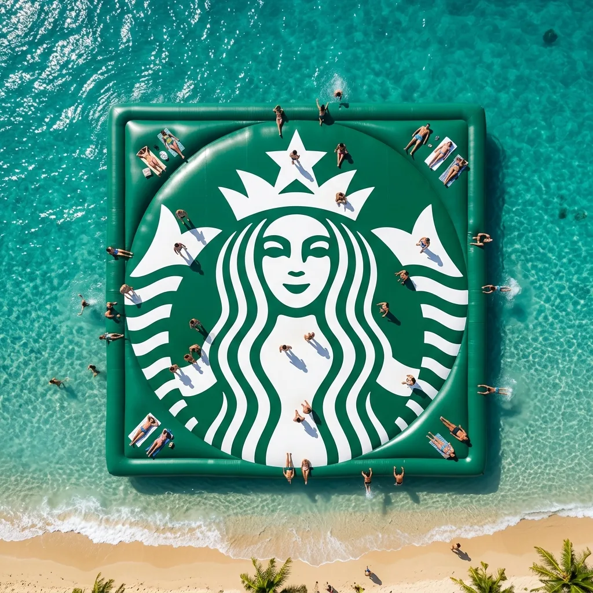

# Massive giant inflatable WhatsApp logo floating in the ocean

[← Back to the collection](../../README.md) · Category: [Illustration & 3D](../../gallery/illustration-3d.md) · Model: `Vinano Image v2` · ID: `vn-00094`

<a href="https://vinano.ai?utm_source=github&utm_medium=readme&utm_campaign=awesome-image-video-prompts-updating&utm_content=prompt-page-image"></a>

<sub>Preview generated with <a href="https://vinano.ai?utm_source=github&utm_medium=readme&utm_campaign=awesome-image-video-prompts-updating&utm_content=prompt-page-caption">vinano.ai</a></sub>

## Prompt

```text
{
 "prompt": "massive giant inflatable WhatsApp logo floating in the ocean near the beach, huge rectangular green mermaid logo white siren face, long flowing white wavy hair, green crown stars, ultra-detailed brand-accurate WhatsApp siren, enormous 100-meter diameter inflatable platform, emerald green rubber texture subtle glossy highlights, classic green and white color scheme, dozens of people in swimsuits playing and lying on the giant inflatable, some standing, some sitting, some swimming around the edges, tropical beach setting, golden sand, turquoise ocean waves gently crashing around the edges, bright sunny day, aerial drone top-down perspective, very wide angle overhead shot, crystal clear water, people casting small shadows on the white face, vibrant summer atmosphere, advertising campaign style, hyperrealistic, extremely detailed, 8k",
 "negative_prompt": "text, letters, words, deformed, blurry, low resolution, bad anatomy, extra limbs, watermark, logo in corner, people inside the face, dark mood, night, winter, snow, ugly, cartoon, illustration, painting, sketch, 3d render, plastic toy look",
 "aspect_ratio": "16:9",
 "style": "true-to-life photorealistic",
 "lighting": "bright natural sunlight, golden hour rim light, soft shadows",
 "camera": "drone aerial view, directly overhead, 200mm lens, slight wide angle distortion",
 "quality_tags": "masterpiece, best quality, ultra detailed, highly detailed, sharp focus, filmic, cinematic lighting, 8k resolution"
}

Keep edges clean and the overall composition balanced for a polished, gallery-ready result.
```

## Try it on vinano.ai

1. Copy the prompt above.
2. Open **[vinano.ai](https://vinano.ai?utm_source=github&utm_medium=readme&utm_campaign=awesome-image-video-prompts-updating&utm_content=prompt-page-try)**, paste it into the image generator and pick a model.
3. Swap any placeholders (brand, product, city, person…) for your own details, then generate.

More prompts like this: [Illustration & 3D gallery](../../gallery/illustration-3d.md) · [all categories](../../README.md#contents)
