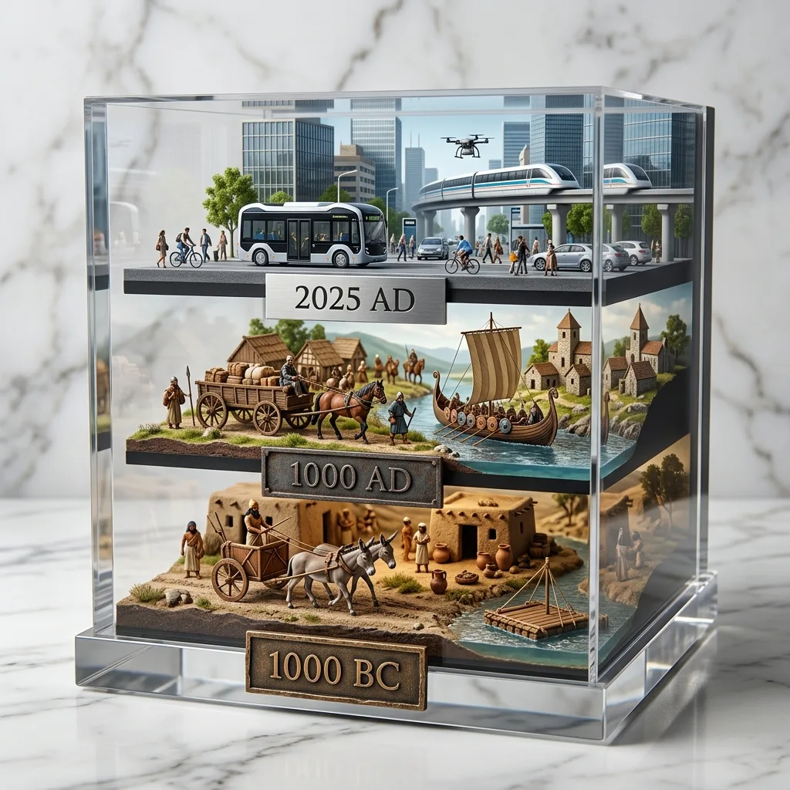

# Stacked depth composition of ultra-detailed 16K 3D-scanned transportation evolving

[← Back to the collection](../../README.md) · Category: [Illustration & 3D](../../gallery/illustration-3d.md) · Model: `Vinano Image v2` · ID: `vn-00096`

<a href="https://vinano.ai?utm_source=github&utm_medium=readme&utm_campaign=awesome-image-video-prompts-updating&utm_content=prompt-page-image"></a>

<sub>Preview generated with <a href="https://vinano.ai?utm_source=github&utm_medium=readme&utm_campaign=awesome-image-video-prompts-updating&utm_content=prompt-page-caption">vinano.ai</a></sub>

## Prompt

```text
Cinematic, hyper-realistic. A stacked depth composition of ultra-detailed 16K 3D-scanned transportation evolving over time, each layer at 1:18 scale [ELEMENTS = era-relevant elements, scenes, vehicles]. Mounted on an acrylic stack base refractive layers. Foreground lighting penetrates to cast multi-layered, receding shadows. From front to back: - ["1000 BC"]: [hyper realistic, era relevant ELEMENTS] - ["1000 AD"]: [hyper realistic, era relevant ELEMENTS] - ["2025 AD"]: [hyper realistic, era relevant ELEMENTS] Set against a marble background. Ultra-realistic 4K HDR render. Preserve realistic proportions and depth for a confident, professional finish.
```

## Try it on vinano.ai

1. Copy the prompt above.
2. Open **[vinano.ai](https://vinano.ai?utm_source=github&utm_medium=readme&utm_campaign=awesome-image-video-prompts-updating&utm_content=prompt-page-try)**, paste it into the image generator and pick a model.
3. Swap any placeholders (brand, product, city, person…) for your own details, then generate.

More prompts like this: [Illustration & 3D gallery](../../gallery/illustration-3d.md) · [all categories](../../README.md#contents)
