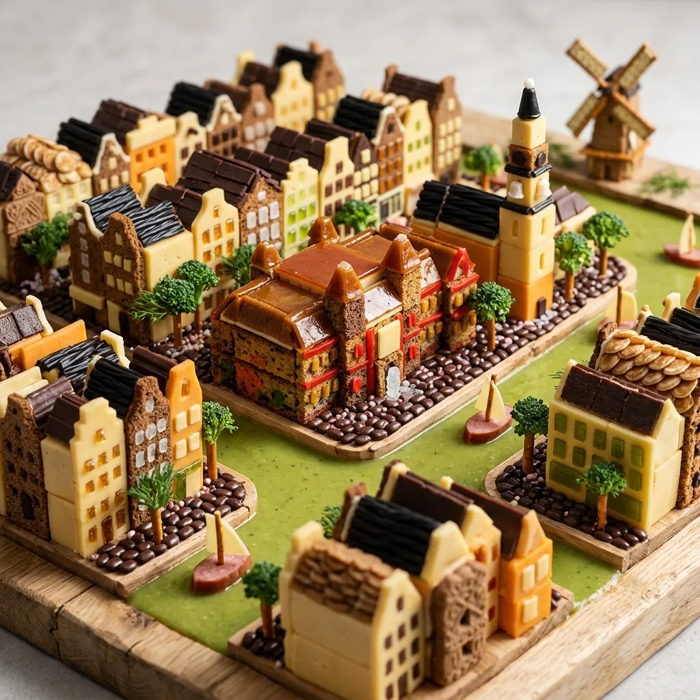

# Country/City Name ::4 Morphology

[← Back to the collection](../../README.md) · Category: [Illustration & 3D](../../gallery/illustration-3d.md) · Model: `Vinano Image Pro` · ID: `vn-00107`

<a href="https://vinano.ai?utm_source=github&utm_medium=readme&utm_campaign=awesome-image-video-prompts-updating&utm_content=prompt-page-image"></a>

<sub>Preview generated with <a href="https://vinano.ai?utm_source=github&utm_medium=readme&utm_campaign=awesome-image-video-prompts-updating&utm_content=prompt-page-caption">vinano.ai</a></sub>

## Prompt

```text
[Country/City Name]::4
Morphology: Miniature architectural cityscape, skyline constructed entirely from edible ingredients, tiny skyscrapers and houses mimicking [Country/City] architectural styles but formed from food, culinary structural engineering, hyper-detailed diorama::3
Material Physics: [Country/City] national gastronomy as construction material, native cuisine textures replacing concrete and glass, masonry made of regional staples, savory and sweet ingredient structural integrity, authentic local food palette::3
Illumination: Soft focus macro lighting, ambient occlusion, mouth-watering highlights::2
Render Stack: Tilt-shift photography, macro lens, f/2.8, 8k, scale model aesthetic, unreal engine 5 render::1
Negative: [Real concrete, real metal, plastic, inedible, humans, cutlery, plates, blurry]:: -1

Preserve realistic proportions and depth for a confident, professional finish.
```

## Try it on vinano.ai

1. Copy the prompt above.
2. Open **[vinano.ai](https://vinano.ai?utm_source=github&utm_medium=readme&utm_campaign=awesome-image-video-prompts-updating&utm_content=prompt-page-try)**, paste it into the image generator and pick a model.
3. Swap any placeholders (brand, product, city, person…) for your own details, then generate.

More prompts like this: [Illustration & 3D gallery](../../gallery/illustration-3d.md) · [all categories](../../README.md#contents)
