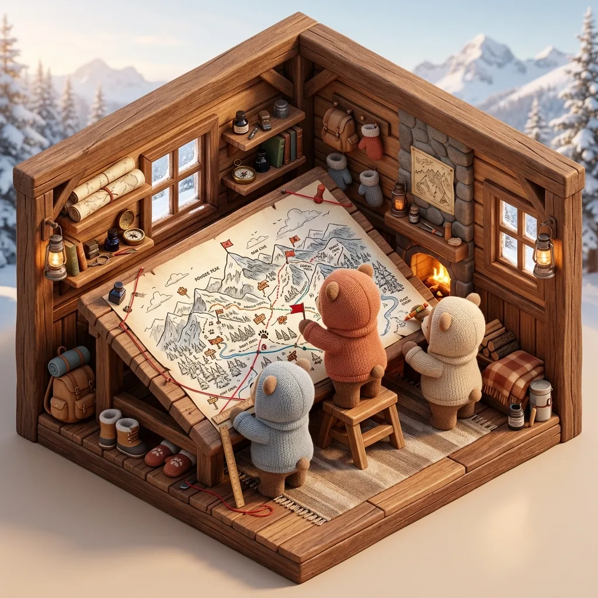

# Isometric 3D kawaii scene of chibi baby bears designing

[← Back to the collection](../../README.md) · Category: [Illustration & 3D](../../gallery/illustration-3d.md) · Model: `Vinano Image Pro` · ID: `vn-00108`

<a href="https://vinano.ai?utm_source=github&utm_medium=readme&utm_campaign=awesome-image-video-prompts-updating&utm_content=prompt-page-image"></a>

<sub>Preview generated with <a href="https://vinano.ai?utm_source=github&utm_medium=readme&utm_campaign=awesome-image-video-prompts-updating&utm_content=prompt-page-caption">vinano.ai</a></sub>

## Prompt

```text
{
 "prompt": "Isometric 3D kawaii scene of chibi baby bears designing a mountain snow map inside a cozy wooden hideout. The isometric cutaway room features a large hand-drawn map spread across a tilted work table, decorated tiny flags, paw-print markers, and string lines connecting different locations. Three baby bears wear soft hooded outfits in warm terracotta, foggy blue, and oatmeal beige. One bear stands on a small stool placing a flag on the map, another measures distances a string and wooden ruler, while the third sketches snowy paths a crayon. The room includes wooden shelves filled rolled maps, compasses, ink bottles, backpacks, and snow boots placed near the door. Small windows reveal snow-covered mountains and pine forests outside.",
 "style": {
 "art_style": "kawaii 3D",
 "perspective": "isometric cutaway",
 "geometry": "rounded, toy-like proportions",
 "render_type": "ultra-detailed 3D render"
 },
 "lighting": {
 "type": "warm indoor lighting",
 "mood": "soft and cozy",
 "contrast": "gentle highlights smooth shadows"
 },
 "color_palette": {
 "primary": ["pastel earthy tones"],
 "accent": ["warm terracotta", "foggy blue", "oatmeal beige"]
 },
 "atmosphere": {
 "emotion": "wholesome and adventurous",
 "vibe": "cozy, playful, story-driven"
 },
 "quality": {
 "detail_level": "ultra detailed",
 "resolution": "8k",
 "rating": "masterpiece, premium quality"
 }
}

Emphasise material texture and natural light so the final frame feels tactile and premium.
```

## Try it on vinano.ai

1. Copy the prompt above.
2. Open **[vinano.ai](https://vinano.ai?utm_source=github&utm_medium=readme&utm_campaign=awesome-image-video-prompts-updating&utm_content=prompt-page-try)**, paste it into the image generator and pick a model.
3. Swap any placeholders (brand, product, city, person…) for your own details, then generate.

More prompts like this: [Illustration & 3D gallery](../../gallery/illustration-3d.md) · [all categories](../../README.md#contents)
