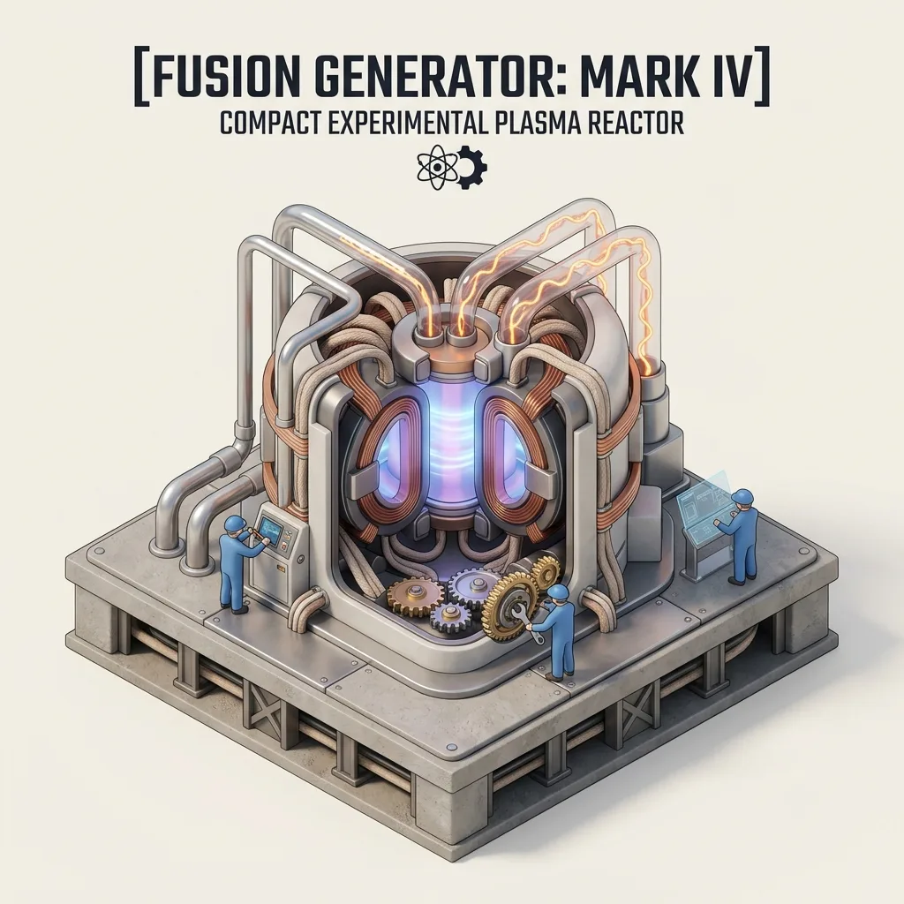

# Clear, 45° top-down isometric miniature 3D cutaway diorama showing

[← Back to the collection](../../README.md) · Category: [Illustration & 3D](../../gallery/illustration-3d.md) · Model: `Vinano Image Pro` · ID: `vn-00115`

<a href="https://vinano.ai?utm_source=github&utm_medium=readme&utm_campaign=awesome-image-video-prompts-updating&utm_content=prompt-page-image"></a>

<sub>Preview generated with <a href="https://vinano.ai?utm_source=github&utm_medium=readme&utm_campaign=awesome-image-video-prompts-updating&utm_content=prompt-page-caption">vinano.ai</a></sub>

## Prompt

```text
Create a clear, 45° top-down isometric miniature 3D cutaway diorama showing the inside of [MACHINE / DEVICE].

Use soft refined textures, realistic PBR materials, and clean technical lighting.

Design a raised base visible internal components, wiring, gears, or energy flow paths.
Include tiny stylized technicians interacting the machinery (no facial details).

Use a clean solid [BACKGROUND COLOR] background.

At the top-center, display [MACHINE NAME] in large bold text, beneath it show a short technical subtitle, and place a minimal engineering icon below.

All text must automatically match the background contrast (white or black).

Keep edges clean and the overall composition balanced for a polished, gallery-ready result.
```

## Try it on vinano.ai

1. Copy the prompt above.
2. Open **[vinano.ai](https://vinano.ai?utm_source=github&utm_medium=readme&utm_campaign=awesome-image-video-prompts-updating&utm_content=prompt-page-try)**, paste it into the image generator and pick a model.
3. Swap any placeholders (brand, product, city, person…) for your own details, then generate.

More prompts like this: [Illustration & 3D gallery](../../gallery/illustration-3d.md) · [all categories](../../README.md#contents)
