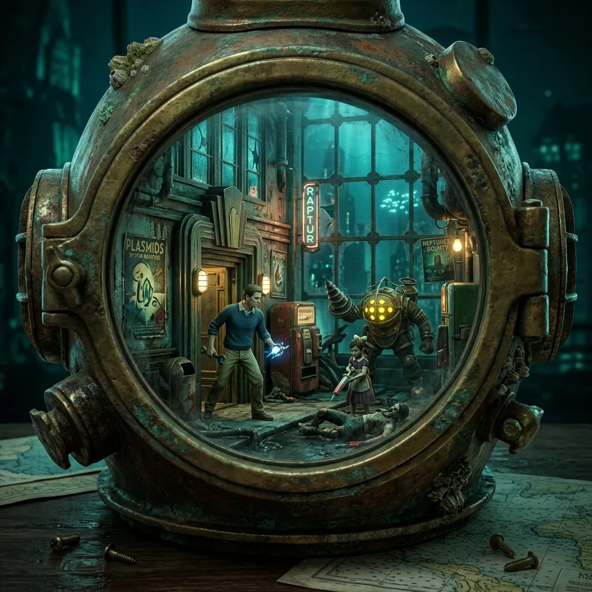

# For every input, you will analyze the core identity

[← Back to the collection](../../README.md) · Category: [Illustration & 3D](../../gallery/illustration-3d.md) · Model: `Vinano Image Pro` · ID: `vn-00125`

<a href="https://vinano.ai?utm_source=github&utm_medium=readme&utm_campaign=awesome-image-video-prompts-updating&utm_content=prompt-page-image"></a>

<sub>Preview generated with <a href="https://vinano.ai?utm_source=github&utm_medium=readme&utm_campaign=awesome-image-video-prompts-updating&utm_content=prompt-page-caption">vinano.ai</a></sub>

## Prompt

```text
<instructions> you are a world class visual artist and viral content generator tasked creating high-concept 3D diorama for games or books. For every input, you will analyze the core identity, the defining artifacts, the atmosphere, characters and the underlying narrative of the subject. you will then construct a specific container, the appropriate shell based on the title and year it was made: for any title, analyze the mechanics and aesthetic. visualize a hollowed-out item. the interior is a diorama of a famous level. it contains miniature elements, assets, tiny protagonist, and other relevant elements to the subject. lighting & style should be appropriate for the title </instructions> Preserve realistic proportions and depth for a confident, professional finish.
```

## Try it on vinano.ai

1. Copy the prompt above.
2. Open **[vinano.ai](https://vinano.ai?utm_source=github&utm_medium=readme&utm_campaign=awesome-image-video-prompts-updating&utm_content=prompt-page-try)**, paste it into the image generator and pick a model.
3. Swap any placeholders (brand, product, city, person…) for your own details, then generate.

More prompts like this: [Illustration & 3D gallery](../../gallery/illustration-3d.md) · [all categories](../../README.md#contents)
