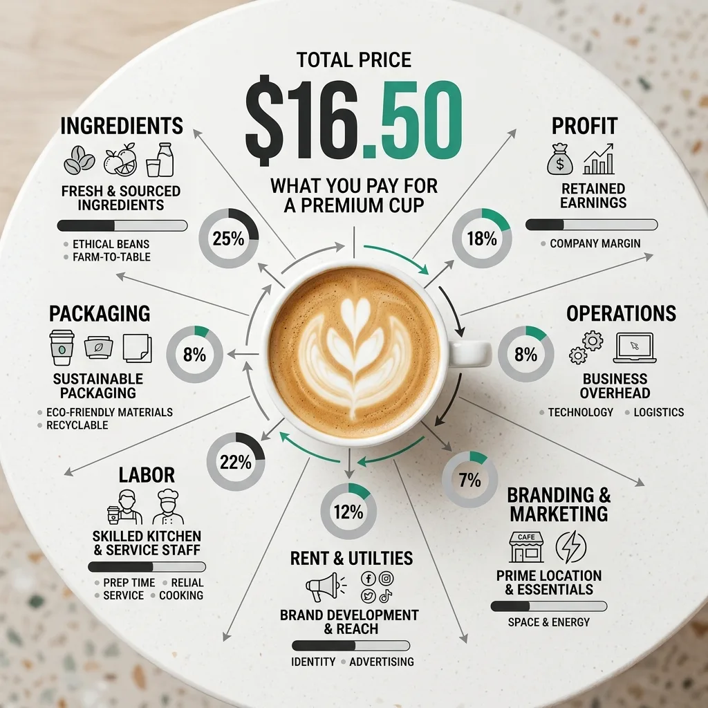

# Illustration & 3D prompt #132

[← Back to the collection](../../README.md) · Category: [Illustration & 3D](../../gallery/illustration-3d.md) · Model: `Vinano Image Pro` · ID: `vn-00132`

<a href="https://vinano.ai?utm_source=github&utm_medium=readme&utm_campaign=awesome-image-video-prompts-updating&utm_content=prompt-page-image"></a>

<sub>Preview generated with <a href="https://vinano.ai?utm_source=github&utm_medium=readme&utm_campaign=awesome-image-video-prompts-updating&utm_content=prompt-page-caption">vinano.ai</a></sub>

## Prompt

```text
Ultra-clean top-down (90° flat lay) infographic. Centered white plate or cup on a light background [PRODUCT] neatly presented.

Surround the food a clear money-flow infographic showing what you pay for: ingredient costs, packaging, labor, rent, branding, operations, and profit. Use icons, percentage bars, pie rings, and arrows flowing outward from the food.

Large price or profit callout as the main focal point, bold sans-serif, high contrast, instantly readable.

Style: premium editorial infographic, Apple UI × National Geographic, clean hierarchy, minimal text, strong visual clarity. Natural food colors, monochrome UI, one accent color for emphasis.

1080×1080, ultra-crisp, no watermark.

Maintain consistent colour harmony and crisp focus across the whole frame.
```

## Try it on vinano.ai

1. Copy the prompt above.
2. Open **[vinano.ai](https://vinano.ai?utm_source=github&utm_medium=readme&utm_campaign=awesome-image-video-prompts-updating&utm_content=prompt-page-try)**, paste it into the image generator and pick a model.
3. Swap any placeholders (brand, product, city, person…) for your own details, then generate.

More prompts like this: [Illustration & 3D gallery](../../gallery/illustration-3d.md) · [all categories](../../README.md#contents)
