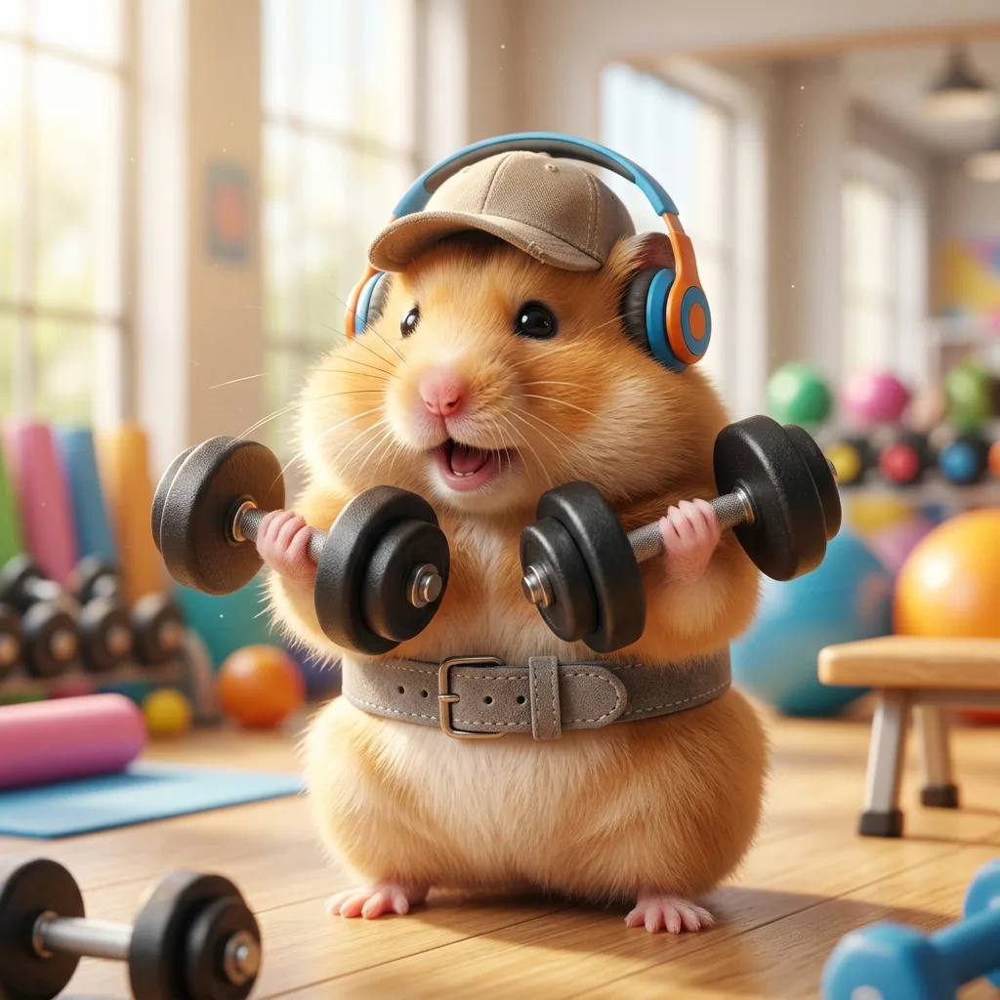

# Hyper-detailed, adorable golden hamster in a bright, cheerful gym

[← Back to the collection](../../README.md) · Category: [Illustration & 3D](../../gallery/illustration-3d.md) · Model: `Vinano Image v2` · ID: `vn-00133`

<a href="https://vinano.ai?utm_source=github&utm_medium=readme&utm_campaign=awesome-image-video-prompts-updating&utm_content=prompt-page-image"></a>

<sub>Preview generated with <a href="https://vinano.ai?utm_source=github&utm_medium=readme&utm_campaign=awesome-image-video-prompts-updating&utm_content=prompt-page-caption">vinano.ai</a></sub>

## Prompt

```text
A hyper-detailed, adorable golden hamster in a bright, cheerful gym, animated in smooth cinematic motion. The chubby hamster, fluffy and round, lifts oversized black dumbbells both tiny paws, bouncing slightly effort. It wears playful over-ear headphones, a backwards beige baseball cap, and a soft grey weightlifting belt. Mouth open in an excited squeak, eyes sparkling joy and determination. Warm, soft, diffused lighting gentle shadows shifts subtly across the scene, highlighting floating dust motes and colorful gym equipment. Camera slowly pans around the hamster, showing dynamic angles from three-quarters and low perspectives. Fun textures and whimsical details remain visible throughout. Motion is lively, charming, and heartwarming, 8K ultra-realistic cinematic style, shallow depth of field, soft focus transitions, gentle ambient gym sounds.
--ar 3:4 --stylize 250 --v 6

Emphasise material texture and natural light so the final frame feels tactile and premium.
```

## Try it on vinano.ai

1. Copy the prompt above.
2. Open **[vinano.ai](https://vinano.ai?utm_source=github&utm_medium=readme&utm_campaign=awesome-image-video-prompts-updating&utm_content=prompt-page-try)**, paste it into the image generator and pick a model.
3. Swap any placeholders (brand, product, city, person…) for your own details, then generate.

More prompts like this: [Illustration & 3D gallery](../../gallery/illustration-3d.md) · [all categories](../../README.md#contents)
