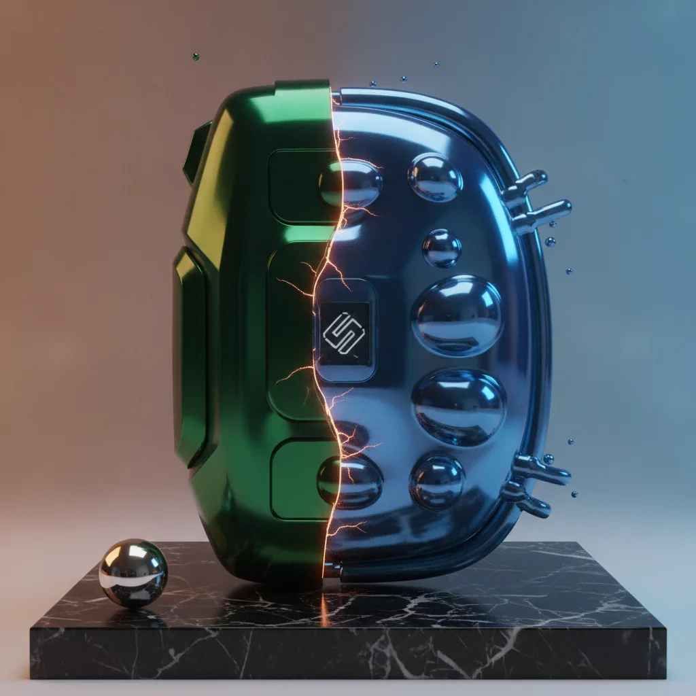

# PRODUCT in color-shifting chrome COLOR to COLOR captured mid-transformation

[← Back to the collection](../../README.md) · Category: [Illustration & 3D](../../gallery/illustration-3d.md) · Model: `Vinano Image` · ID: `vn-00136`

<a href="https://vinano.ai?utm_source=github&utm_medium=readme&utm_campaign=awesome-image-video-prompts-updating&utm_content=prompt-page-image"></a>

<sub>Preview generated with <a href="https://vinano.ai?utm_source=github&utm_medium=readme&utm_campaign=awesome-image-video-prompts-updating&utm_content=prompt-page-caption">vinano.ai</a></sub>

## Prompt

```text
A [PRODUCT] in color-shifting chrome [COLOR to COLOR] captured mid-transformation: left side rigid and angular, right side impossibly inflated like a balloon. [MAIN BODY] pillowy and bulging. [BUTTONS/CONTROLS] swollen into soft puffy domes. [EDGES/CORNERS] ballooned into smooth tubes. [SURFACE DETAILS/LOGOS] risen like chrome blisters. [PORTS/JOINTS] threatening to burst at the seams. Thin stress fractures glow molten copper-gold at the transformation boundary, small chrome droplets floating mid-air. Warped reflections of a luxury showroom in the curved surfaces. A single mercury sphere beside it for scale. Positioned on [PLACE], gradient backdrop [COLOR]. Split lighting, warm tungsten on rigid sections, cool LED on inflated forms, caustic patterns cast below. Surrealist meets luxury automotive. Sharp specular on angular parts, soft highlights tracing inflation pressure. Single hero object between states, ultra-high resolution, the weight that floats. Emphasise material texture and natural light so the final frame feels tactile and premium.
```

## Try it on vinano.ai

1. Copy the prompt above.
2. Open **[vinano.ai](https://vinano.ai?utm_source=github&utm_medium=readme&utm_campaign=awesome-image-video-prompts-updating&utm_content=prompt-page-try)**, paste it into the image generator and pick a model.
3. Swap any placeholders (brand, product, city, person…) for your own details, then generate.

More prompts like this: [Illustration & 3D gallery](../../gallery/illustration-3d.md) · [all categories](../../README.md#contents)
