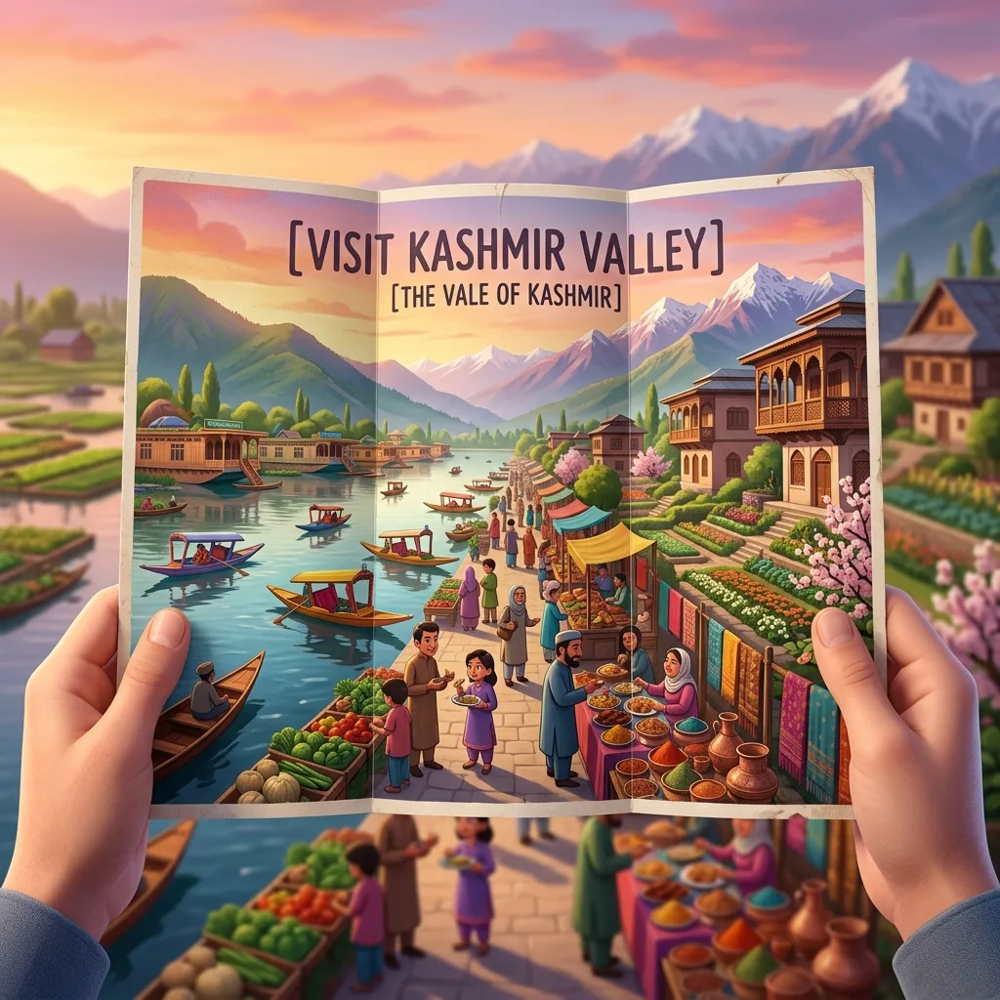

# Promotional Create a high-resolution 1080x1080 stylized travel poster style

[← Back to the collection](../../README.md) · Category: [Illustration & 3D](../../gallery/illustration-3d.md) · Model: `Vinano Image Pro` · ID: `vn-00139`

<a href="https://vinano.ai?utm_source=github&utm_medium=readme&utm_campaign=awesome-image-video-prompts-updating&utm_content=prompt-page-image"></a>

<sub>Preview generated with <a href="https://vinano.ai?utm_source=github&utm_medium=readme&utm_campaign=awesome-image-video-prompts-updating&utm_content=prompt-page-caption">vinano.ai</a></sub>

## Prompt

```text
Ultra-Realistic Promotional
Create a high-resolution 1080x1080 stylized travel poster style illustration that looks like a folded tourist brochure being held by two hands in the foreground. The brochure features a vibrant, cartoonish yet detailed depiction of [KASHMIR VALLEY] Show iconic cultural elements and architecture of [Often Called VALE OF KASHMIR] surrounded by lush greenery or local landscapes. Include shopping scenes people eating street food at local markets, and colorful [SUN/SUNSET] in the background. The overall style should be Pixar-inspired, bright and cheerful, soft shadows, and rich 3D depth. The hands holding the brochure should be pixar stylized, gentle shadows and cool tones, matching the exact expression and perspective as the reference image. The background should seamlessly blend and match the landscape extending beyond the brochure edges.

Maintain consistent colour harmony and crisp focus across the whole frame.
```

## Try it on vinano.ai

1. Copy the prompt above.
2. Open **[vinano.ai](https://vinano.ai?utm_source=github&utm_medium=readme&utm_campaign=awesome-image-video-prompts-updating&utm_content=prompt-page-try)**, paste it into the image generator and pick a model.
3. Swap any placeholders (brand, product, city, person…) for your own details, then generate.

More prompts like this: [Illustration & 3D gallery](../../gallery/illustration-3d.md) · [all categories](../../README.md#contents)
