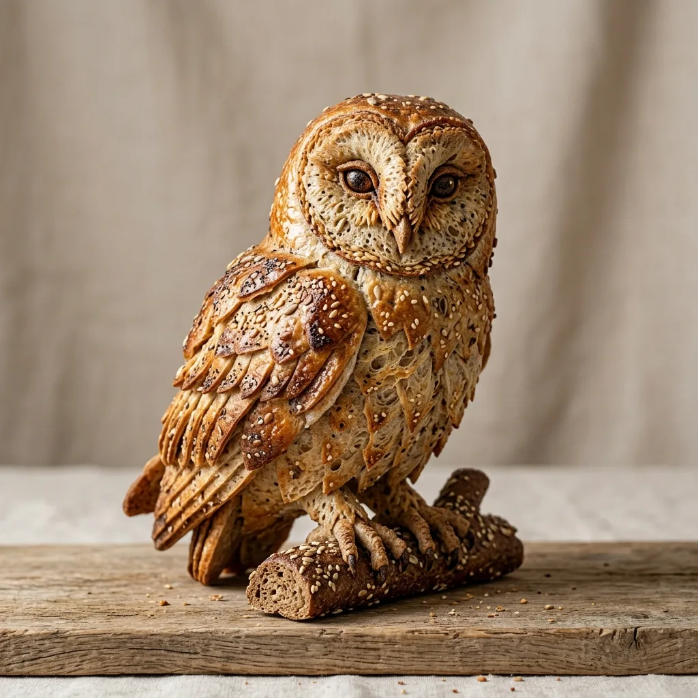

# Highly realistic sculpture of a object , crafted entirely

[← Back to the collection](../../README.md) · Category: [Illustration & 3D](../../gallery/illustration-3d.md) · Model: `Vinano Image v2` · ID: `vn-00146`

<a href="https://vinano.ai?utm_source=github&utm_medium=readme&utm_campaign=awesome-image-video-prompts-updating&utm_content=prompt-page-image"></a>

<sub>Preview generated with <a href="https://vinano.ai?utm_source=github&utm_medium=readme&utm_campaign=awesome-image-video-prompts-updating&utm_content=prompt-page-caption">vinano.ai</a></sub>

## Prompt

```text
A highly realistic sculpture of a [object], crafted entirely from [bread type], true-to-life photorealistic, ultra detailed bread texture, authentic crumb structure, golden brown crust subtle blistering, natural sheen from baked glaze, visible flaky layers or airy pockets where appropriate, sesame or poppy seeds embedded if relevant, tiny cracks and toasted edges, realistic thickness and weight, studio product lighting soft highlights and gentle shadows, soft neutral seamless background, shallow depth of field, razor sharp focus on the sculpture, 8k, no text, no logos, no watermark Maintain consistent colour harmony and crisp focus across the whole frame.
```

## Try it on vinano.ai

1. Copy the prompt above.
2. Open **[vinano.ai](https://vinano.ai?utm_source=github&utm_medium=readme&utm_campaign=awesome-image-video-prompts-updating&utm_content=prompt-page-try)**, paste it into the image generator and pick a model.
3. Swap any placeholders (brand, product, city, person…) for your own details, then generate.

More prompts like this: [Illustration & 3D gallery](../../gallery/illustration-3d.md) · [all categories](../../README.md#contents)
