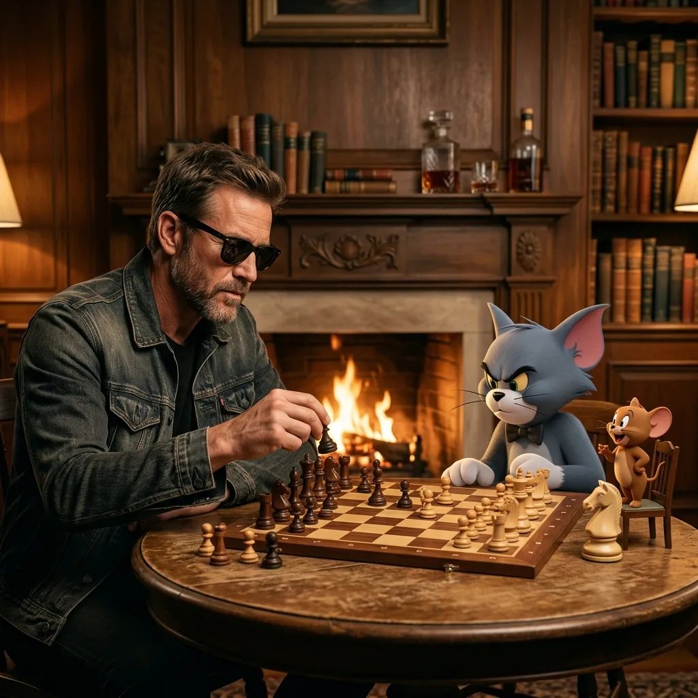

# Scene of a stylish man wearing sunglasses

[← Back to the collection](../../README.md) · Category: [Illustration & 3D](../../gallery/illustration-3d.md) · Model: `Vinano Image v2` · ID: `vn-00169`

<a href="https://vinano.ai?utm_source=github&utm_medium=readme&utm_campaign=awesome-image-video-prompts-updating&utm_content=prompt-page-image"></a>

<sub>Preview generated with <a href="https://vinano.ai?utm_source=github&utm_medium=readme&utm_campaign=awesome-image-video-prompts-updating&utm_content=prompt-page-caption">vinano.ai</a></sub>

## Prompt

```text
A cinematic, ultra-realistic scene of a stylish man wearing sunglasses and a denim jacket, seated at a round wooden table in a warm, wood-paneled study a fireplace glowing in the background. He is playing chess against two iconic cartoon-style characters: a grey animated cat and a small brown animated mouse. The mouse stands playfully on a chess piece while the cat focuses on the board. Perfect blend of true-to-life photorealistic human and premium-quality 3D animated characters, Pixar-level rendering for the cartoons, realistic skin textures for the human. Cozy ambient lighting, cinematic shadows, shallow depth of field, dramatic composition, storytelling mood, hyper-detailed chessboard, 50mm lens look, ultra-sharp focus, 8K ultra-realistic, Hollywood movie still. Maintain consistent colour harmony and crisp focus across the whole frame.
```

## Try it on vinano.ai

1. Copy the prompt above.
2. Open **[vinano.ai](https://vinano.ai?utm_source=github&utm_medium=readme&utm_campaign=awesome-image-video-prompts-updating&utm_content=prompt-page-try)**, paste it into the image generator and pick a model.
3. Swap any placeholders (brand, product, city, person…) for your own details, then generate.

More prompts like this: [Illustration & 3D gallery](../../gallery/illustration-3d.md) · [all categories](../../README.md#contents)
