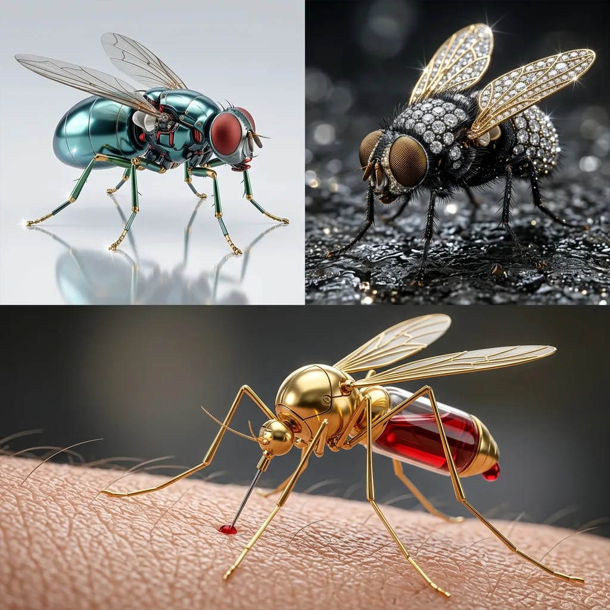

# 3:4 , render quality

[← Back to the collection](../../README.md) · Category: [Illustration & 3D](../../gallery/illustration-3d.md) · Model: `Vinano Image v2` · ID: `vn-00173`

<a href="https://vinano.ai?utm_source=github&utm_medium=readme&utm_campaign=awesome-image-video-prompts-updating&utm_content=prompt-page-image"></a>

<sub>Preview generated with <a href="https://vinano.ai?utm_source=github&utm_medium=readme&utm_campaign=awesome-image-video-prompts-updating&utm_content=prompt-page-caption">vinano.ai</a></sub>

## Prompt

```text
{
 "resolution": "Ultra HD 8K",
 "aspect_ratio": "3:4",
 "render_quality": "extreme macro detail, studio-grade sharpness, high dynamic range",
 "lighting": "controlled studio lighting, strong specular highlights, crisp reflections, soft shadows",
 "focus": "ultra-sharp foreground, shallow depth of field background",
 "style": "hyper-detailed AI-edited macro realism",

 "MODULE_1_IMAGE_1_STYLE": {
 "subject": "mechanical insect resembling a fly",
 "pose": "standing on a reflective flat surface, body angled slightly forward, legs spread naturally",
 "body_structure": {
 "abdomen": "smooth oval metallic teal body mirror-like reflections",
 "thorax": "complex mechanical structure visible joints and red accent components",
 "head": "large spherical red compound eyes matte finish",
 "legs": "thin metallic legs, green-tinted segments gold-colored joints and tips",
 "wings": "two translucent wings visible vein patterns, slightly raised"
 },
 "materials": {
 "primary": "polished metal, glass-like surfaces",
 "secondary": "gold-toned joints, red accent nodes"
 },
 "surface_interaction": "sharp reflections visible beneath legs and abdomen",
 "background": "clean light gray to white gradient no visible texture",
 "visual_effects": ["star-like light flares on metallic surfaces",
 "high-gloss reflections",
 "precision macro clarity"]
 },

 "MODULE_2_IMAGE_2_STYLE": {
 "subject": "organic fly covered jewel-like elements",
 "pose": "standing on a dark textured surface, body angled slightly left",
 "body_structure": {
 "head": "large compound eyes brown-gold mesh texture",
 "body": "dense black hair-like texture beneath embedded gemstones",
 "abdomen": "rounded form densely covered in diamond-like crystals",
 "legs": "thin black insect legs fine hair details",
 "wings": "two wings fully visible, gold-veined framework filled clear gemstone-like facets"
 },
 "materials": {
 "primary": "diamond-like crystals",
 "secondary": "gold metallic wing veins",
 "organic_elements": "fine black bristles and hairs"
 },
 "surface_interaction": "wet-looking dark ground subtle sparkle",
 "background": "dark blurred background soft bokeh",
 "visual_effects": ["micro light reflections in gemstones",
 "sparkling highlights",
 "high contrast macro lighting"]
 },

 "MODULE_3_IMAGE_3_STYLE": {
 "subject": "golden mechanical mosquito-like insect",
 "pose": "feeding posture proboscis touching skin surface",
 "body_structure": {
 "head": "smooth polished gold spherical head visible mechanical seams",
 "proboscis": "thin metallic needle-like structure a visible red droplet at the tip",
 "abdomen": "transparent cylindrical chamber partially filled red liquid",
 "legs": "long thin gold metallic legs bent at sharp angles",
 "wings": "two translucent wings gold vein structures, angled upward"
 },
 "materials": {
 "primary": "polished gold metal",
 "secondary": "clear glass-like container",
 "liquid": "deep red translucent fluid"
 },
 "surface_interaction": "human skin texture visible pores and natural unevenness",
 "background": "dark neutral gradient soft falloff",
 "visual_effects": ["precise reflections on gold surfaces",
 "realistic liquid refraction",
 "macro skin texture clarity"]
 }
 }
}

Preserve realistic proportions and depth for a confident, professional finish.
```

## Try it on vinano.ai

1. Copy the prompt above.
2. Open **[vinano.ai](https://vinano.ai?utm_source=github&utm_medium=readme&utm_campaign=awesome-image-video-prompts-updating&utm_content=prompt-page-try)**, paste it into the image generator and pick a model.
3. Swap any placeholders (brand, product, city, person…) for your own details, then generate.

More prompts like this: [Illustration & 3D gallery](../../gallery/illustration-3d.md) · [all categories](../../README.md#contents)
