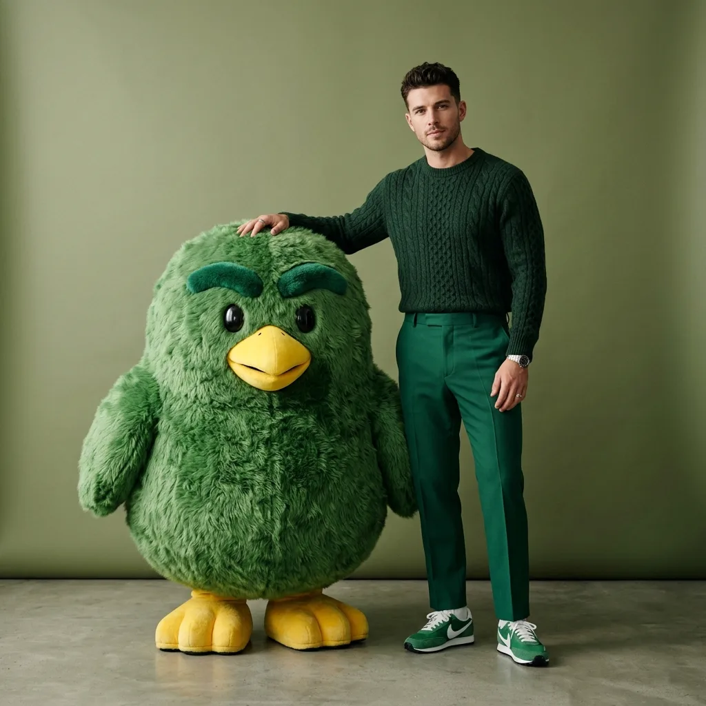

# High-end studio fashion portrait of a handsome male model

[← Back to the collection](../../README.md) · Category: [Illustration & 3D](../../gallery/illustration-3d.md) · Model: `Vinano Image v2` · ID: `vn-00174`

<a href="https://vinano.ai?utm_source=github&utm_medium=readme&utm_campaign=awesome-image-video-prompts-updating&utm_content=prompt-page-image"></a>

<sub>Preview generated with <a href="https://vinano.ai?utm_source=github&utm_medium=readme&utm_campaign=awesome-image-video-prompts-updating&utm_content=prompt-page-caption">vinano.ai</a></sub>

## Prompt

```text
High-end studio fashion portrait of a handsome male model standing beside a large plush green cartoon bird mascot. Minimal matte green background soft tonal gradient. Model wearing a dark green cable-knit sweater, tailored emerald green trousers, and green sneakers, one hand resting casually on the mascot’s head, relaxed confident posture. Mascot is oversized, round, plush-textured, vivid green thick expressive eyebrows, glossy eyes, and a bright yellow beak and feet. Soft diffused studio lighting, subtle shadows, ultra-sharp focus, rich fabric and texture detail, premium fashion campaign aesthetic, crisp composition, modern playful luxury vibe, high resolution. Aim for an editorial, design-driven look with deliberate negative space.
```

## Try it on vinano.ai

1. Copy the prompt above.
2. Open **[vinano.ai](https://vinano.ai?utm_source=github&utm_medium=readme&utm_campaign=awesome-image-video-prompts-updating&utm_content=prompt-page-try)**, paste it into the image generator and pick a model.
3. Swap any placeholders (brand, product, city, person…) for your own details, then generate.

More prompts like this: [Illustration & 3D gallery](../../gallery/illustration-3d.md) · [all categories](../../README.md#contents)
