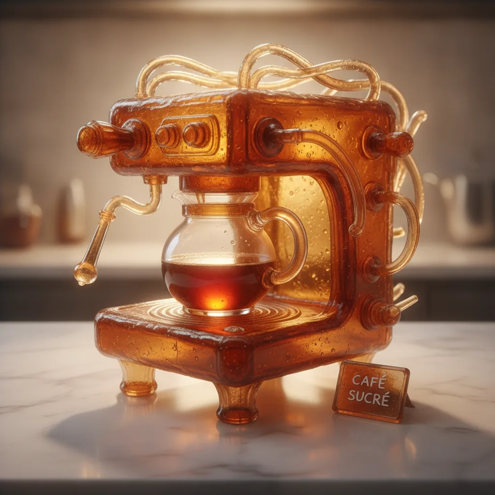

# PRODUCT rendered as if built entirely from pulled

[← Back to the collection](../../README.md) · Category: [Illustration & 3D](../../gallery/illustration-3d.md) · Model: `Vinano Image` · ID: `vn-00178`

<a href="https://vinano.ai?utm_source=github&utm_medium=readme&utm_campaign=awesome-image-video-prompts-updating&utm_content=prompt-page-image"></a>

<sub>Preview generated with <a href="https://vinano.ai?utm_source=github&utm_medium=readme&utm_campaign=awesome-image-video-prompts-updating&utm_content=prompt-page-caption">vinano.ai</a></sub>

## Prompt

```text
A [PRODUCT] rendered as if built entirely from pulled and blown sugar, the translucent amber material of patisserie showpieces forming functional object. Visible sugar work techniques: pulled ribbons, blown bubbles, cast pieces joined caramel. Internal air bubbles, slight amber color variation, the architectural fragility of competition sugar work. Positioned on a marble pastry surface or against cream backdrop. French patisserie tradition meets industrial design. Warm lighting that passes through the sugar, creating honey-glow internal illumination. Sharp focus, warm amber palette, edible luxury aesthetic, ultra-high resolution, the functional made confection.

Check ALTs for ideas 👇

Preserve realistic proportions and depth for a confident, professional finish.
```

## Try it on vinano.ai

1. Copy the prompt above.
2. Open **[vinano.ai](https://vinano.ai?utm_source=github&utm_medium=readme&utm_campaign=awesome-image-video-prompts-updating&utm_content=prompt-page-try)**, paste it into the image generator and pick a model.
3. Swap any placeholders (brand, product, city, person…) for your own details, then generate.

More prompts like this: [Illustration & 3D gallery](../../gallery/illustration-3d.md) · [all categories](../../README.md#contents)
