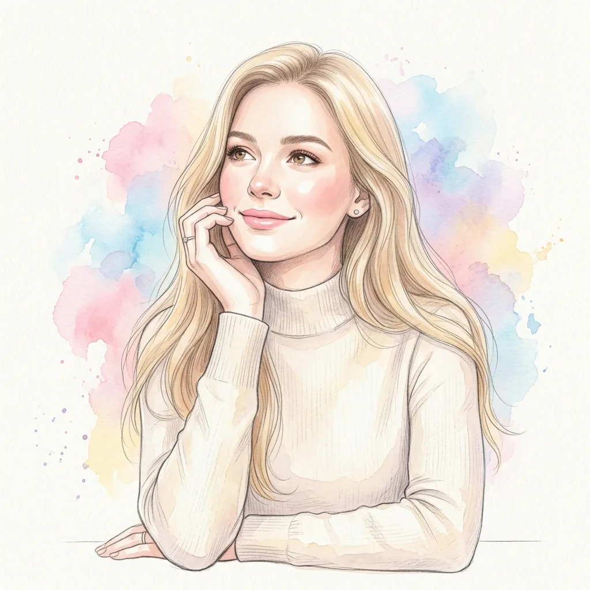

# Soft pastel watercolor digital illustration of a young woman

[← Back to the collection](../../README.md) · Category: [Illustration & 3D](../../gallery/illustration-3d.md) · Model: `Vinano Image v2` · ID: `vn-00181`

<a href="https://vinano.ai?utm_source=github&utm_medium=readme&utm_campaign=awesome-image-video-prompts-updating&utm_content=prompt-page-image"></a>

<sub>Preview generated with <a href="https://vinano.ai?utm_source=github&utm_medium=readme&utm_campaign=awesome-image-video-prompts-updating&utm_content=prompt-page-caption">vinano.ai</a></sub>

## Prompt

```text
A soft pastel watercolor digital illustration of a young woman long, flowing blonde hair, gently smiling and looking slightly upward to the side. She has delicate, realistic facial features, smooth glowing skin, light pink lips, and expressive eyes. She is wearing a light-colored, high-neck long-sleeve sweater subtle fabric texture. One hand is raised near her face in a relaxed, thoughtful pose, the other resting casually on a table or surface.
The art style is a mix of hand-drawn pencil sketch and watercolor painting, fine linework and soft pastel splashes in pink, yellow, lavender, and light blue behind her. The background is minimal and abstract, loose watercolor brush strokes and a clean off-white canvas.
Lighting is soft and dreamy, giving a warm, optimistic, serene mood. The illustration has a modern digital watercolor aesthetic, elegant, airy, and feminine, smooth gradients and painterly textures. High detail, artistic portrait, pastel color palette, aesthetic illustration, soft focus, gentle expression.

Render with rich micro-detail while keeping the layout uncluttered and intentional.
```

## Try it on vinano.ai

1. Copy the prompt above.
2. Open **[vinano.ai](https://vinano.ai?utm_source=github&utm_medium=readme&utm_campaign=awesome-image-video-prompts-updating&utm_content=prompt-page-try)**, paste it into the image generator and pick a model.
3. Swap any placeholders (brand, product, city, person…) for your own details, then generate.

More prompts like this: [Illustration & 3D gallery](../../gallery/illustration-3d.md) · [all categories](../../README.md#contents)
