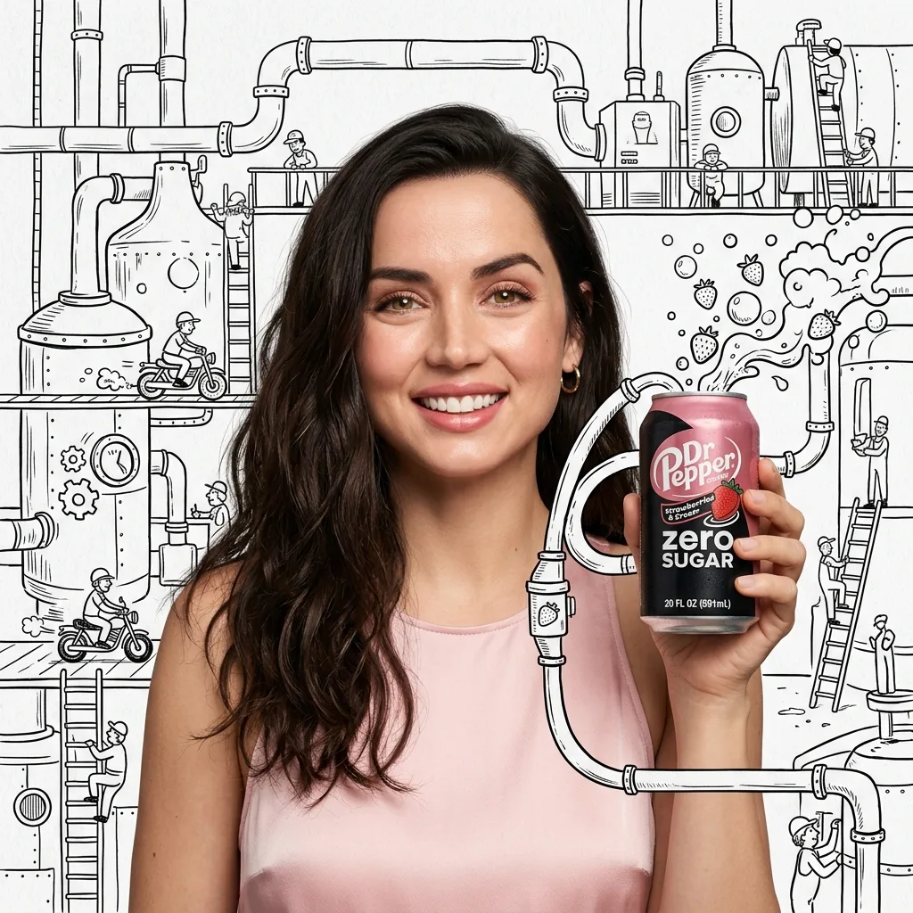

# Premium-quality realistic photograph of Ana de Armas glowing skin

[← Back to the collection](../../README.md) · Category: [Illustration & 3D](../../gallery/illustration-3d.md) · Model: `Vinano Image v2` · ID: `vn-00184`

<a href="https://vinano.ai?utm_source=github&utm_medium=readme&utm_campaign=awesome-image-video-prompts-updating&utm_content=prompt-page-image"></a>

<sub>Preview generated with <a href="https://vinano.ai?utm_source=github&utm_medium=readme&utm_campaign=awesome-image-video-prompts-updating&utm_content=prompt-page-caption">vinano.ai</a></sub>

## Prompt

```text
{
 "prompt": "A premium-quality realistic photograph of Ana de Armas glowing skin, long dark hair, and a bright happy smile showing teeth, holding a can of 'Dr Pepper Strawberries & Cream Zero Sugar' near her face. The background is a creative, whimsical 2D black-and-white line art illustration of a soda factory. The illustration features stylized pipes, industrial tanks, and tiny cartoon workers on ladders and motorbikes. Some of the hand-drawn pipes appear to 'connect' to the soda can, illustrated bubbles flowing out. Ana is wearing a light pink sleeveless top, complementing the soda can aesthetic. Bright, clean studio lighting, 8k resolution, mixed media art style.",
 "key_elements": {
 "mixed_media": "Combine realistic photography of Ana de Armas 2D hand-drawn illustration in one cohesive image",
 "contrast": "Realistic Ana pops against black-and-white line art",
 "interaction": "Illustrated pipes connect to soda can bubbles flowing",
 "color_palette": "Light pink clothing matching pink/red tones of soda can for a high-end commercial look"
 },
 "style": "mixed media, whimsical, high-end commercial",
 "resolution": "8k",
 "lighting": "bright, clean studio lighting"
}

Render with rich micro-detail while keeping the layout uncluttered and intentional.
```

## Try it on vinano.ai

1. Copy the prompt above.
2. Open **[vinano.ai](https://vinano.ai?utm_source=github&utm_medium=readme&utm_campaign=awesome-image-video-prompts-updating&utm_content=prompt-page-try)**, paste it into the image generator and pick a model.
3. Swap any placeholders (brand, product, city, person…) for your own details, then generate.

More prompts like this: [Illustration & 3D gallery](../../gallery/illustration-3d.md) · [all categories](../../README.md#contents)
