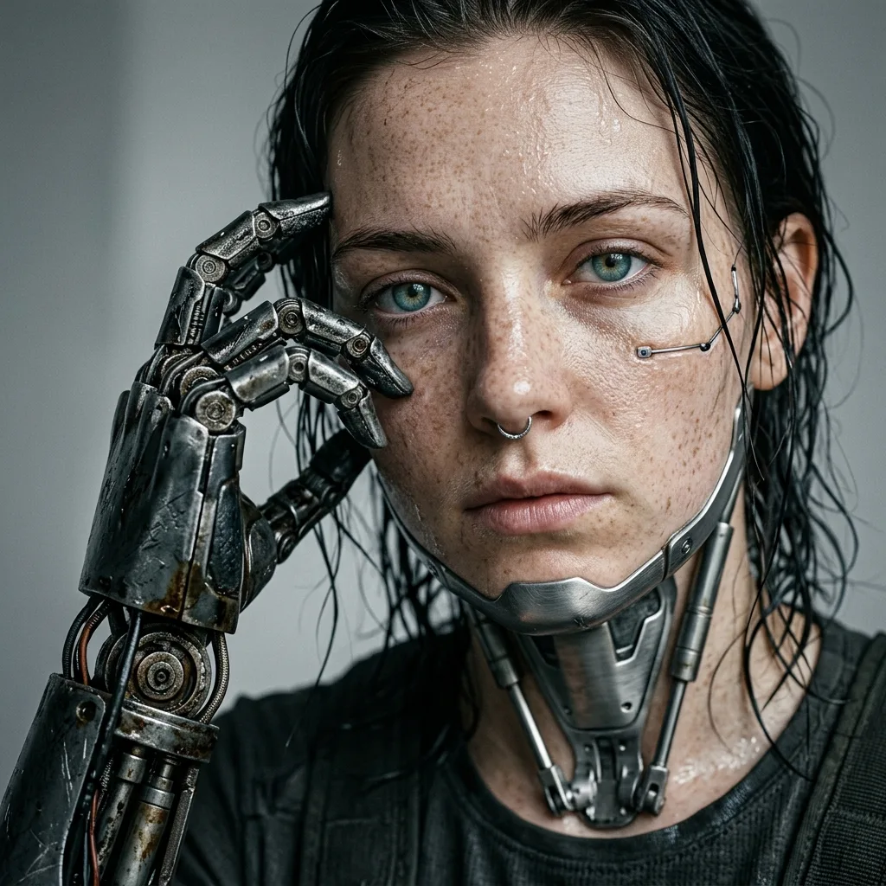

# Extreme close-up portrait of a young woman fair, freckled

[← Back to the collection](../../README.md) · Category: [Illustration & 3D](../../gallery/illustration-3d.md) · Model: `Vinano Image v2` · ID: `vn-00187`

<a href="https://vinano.ai?utm_source=github&utm_medium=readme&utm_campaign=awesome-image-video-prompts-updating&utm_content=prompt-page-image"></a>

<sub>Preview generated with <a href="https://vinano.ai?utm_source=github&utm_medium=readme&utm_campaign=awesome-image-video-prompts-updating&utm_content=prompt-page-caption">vinano.ai</a></sub>

## Prompt

```text
A hyper-realistic, cinematic extreme close-up portrait of a young woman fair, freckled skin and damp, dark hair. She has striking blue-green eyes and a silver septum ring.
Cybernetic Details: A large, highly detailed mechanical prosthetic hand weathered industrial textures, exposed wires, and hydraulic pistons is positioned near her face, fingers curled toward her temple.
A thin, surgical-grade cybernetic wire or sensor line runs horizontally across her cheek, just beneath her eye.
The jawline and neck feature integrated metallic plating and brushed-steel augmentations.

Background: A refined minimalist, neutral studio backdrop in soft grey-white.
Lighting: Soft, directional front-left lighting that creates deep, intricate shadows within the mechanical joints and highlights the moisture on her skin and lips.
Atmosphere: Gritty, futuristic, and melancholic a high-fashion editorial feel.
Composition: Asymmetrical framing, shallow depth of field focusing on the eye and the texture of the robotic fingers.
Texture: Hyper-detailed skin pores, fine wet hair strands, and scratched, oil-stained metal surfaces.
Color Grade: Desaturated cool tones high contrast. High-resolution digital art/3D render style.

Render with rich micro-detail while keeping the layout uncluttered and intentional.
```

## Try it on vinano.ai

1. Copy the prompt above.
2. Open **[vinano.ai](https://vinano.ai?utm_source=github&utm_medium=readme&utm_campaign=awesome-image-video-prompts-updating&utm_content=prompt-page-try)**, paste it into the image generator and pick a model.
3. Swap any placeholders (brand, product, city, person…) for your own details, then generate.

More prompts like this: [Illustration & 3D gallery](../../gallery/illustration-3d.md) · [all categories](../../README.md#contents)
